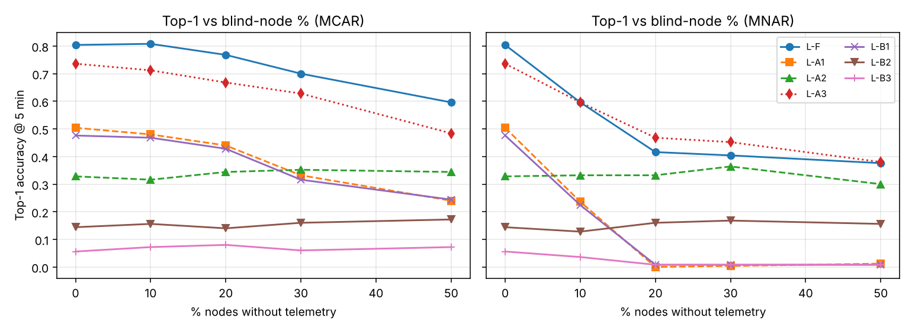
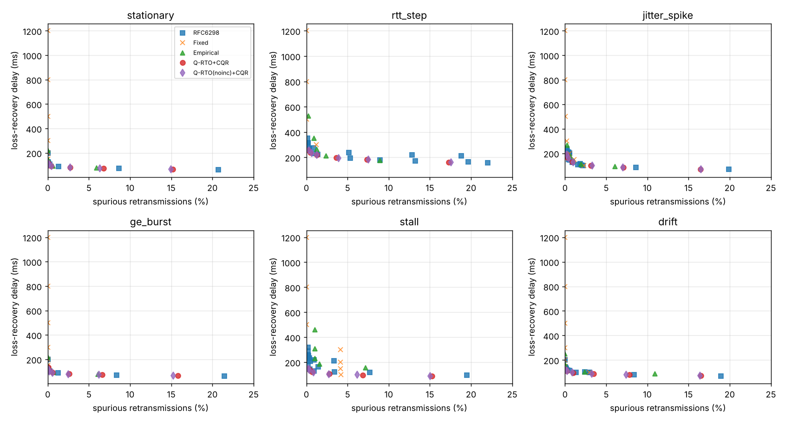

# Results (generated)

> Generated by `experiments/make_report.py` from the run directories cited under each section. **All data are synthetic** (simulated campus, simulated channel). Nothing here is validated on a real network. Re-run with `python tools/campusctl.py exp all`.

## E3 - Fault Localizer (`experiments/runs/E3/0b857f38c7901147-39cae1db`)

Top-1 accuracy of the true faulty device, 5 minutes after onset. Hidden test seeds; train/val/calibration/test are disjoint. L-F = full Bayesian model; L-A* = ablations; L-B* = baselines.

| blind nodes | mode | L-F | L-A3 (no missingness) | L-A1 (telemetry term) | L-A2 (reports term) | L-B1 telemetry-only | L-B2 ticket-dedupe | L-B3 v1 heuristic | conformal cov. | set size |
|---|---|---|---|---|---|---|---|---|---|---|
| 0% | MCAR | 0.804 | 0.736 | 0.504 | 0.328 | 0.476 | 0.144 | 0.056 | 0.928 | 2.9 |
| 10% | MCAR | 0.808 | 0.712 | 0.480 | 0.316 | 0.468 | 0.156 | 0.072 | 0.912 | 3.0 |
| 20% | MCAR | 0.768 | 0.668 | 0.440 | 0.344 | 0.428 | 0.140 | 0.080 | 0.896 | 3.1 |
| 30% | MCAR | 0.700 | 0.628 | 0.332 | 0.352 | 0.316 | 0.160 | 0.060 | 0.824 | 3.1 |
| 50% | MCAR | 0.596 | 0.484 | 0.240 | 0.344 | 0.244 | 0.172 | 0.072 | 0.744 | 3.3 |
| 0% | MNAR | 0.804 | 0.736 | 0.504 | 0.328 | 0.476 | 0.144 | 0.056 | 0.928 | 2.9 |
| 10% | MNAR | 0.596 | 0.596 | 0.236 | 0.332 | 0.224 | 0.128 | 0.036 | 0.800 | 3.4 |
| 20% | MNAR | 0.416 | 0.468 | 0.000 | 0.332 | 0.008 | 0.160 | 0.008 | 0.624 | 4.1 |
| 30% | MNAR | 0.404 | 0.452 | 0.004 | 0.364 | 0.008 | 0.168 | 0.008 | 0.648 | 4.1 |
| 50% | MNAR | 0.376 | 0.380 | 0.012 | 0.300 | 0.008 | 0.156 | 0.008 | 0.604 | 3.8 |

### Pre-registered kill criterion H1 (L-F beats telemetry-only by >= 5 pp at 20 % blind nodes, paired-bootstrap CI excluding 0)

- **MCAR**: L-F minus L-B1 = 34.0 pp (95 % CI 28.0 to 40.0), n=250, **PASS**. Informative-missingness gain over L-A3: 10.0 pp (CI 6.0 to 14.0).
- **MNAR**: L-F minus L-B1 = 40.8 pp (95 % CI 34.8 to 46.8), n=250, **PASS**. Informative-missingness gain over L-A3: -5.2 pp (CI -8.8 to -1.6).

### Other measured results

- Detection of a real fault at 5 min (calibrated P(no fault) < 0.5): **0.847**.
- False incidents on benign scenarios: **0.608** overall; quiet network (`NONE`) **0.246**, benign crowd surge **0.995**.
- Time to localise (calibrated P >= 0.5 and top-1 correct), 20 % blind: L-F median 2.0 min but never localised in 0.212 of cases; L-B1 median 2.0 min, never in 0.504.
- Concurrent AP faults, both in top-3: single-fault posterior 0.658, with pair hypotheses 0.675 (n=120).
- Posterior latency p95: 5.6 ms.

## E5 - ACK timers (`experiments/runs/E5/718ab2f68068e5ee-aa20e930`)

Q-RTO (quantile GBDT + conformal margin) vs baselines on six impairment scenarios, 20 seeds each. A scenario counts as a win only if Q-RTO has lower loss-recovery delay at matched spurious-retransmission rates of 2 % **and** 5 %, with the paired-bootstrap CI excluding 0.

| baseline | scenarios won (of 6) | pre-registered claim (>= 4/6) |
|---|---|---|
| RFC6298 | 5 | supported |
| Fixed | 4 | supported |
| Empirical | 3 | **NOT supported** |

Mean recovery-delay difference (Q-RTO minus RFC 6298, ms; negative = Q-RTO faster) at matched 2 % / 5 % spurious:

| scenario | 2 % | 5 % |
|---|---|---|
| stationary | -4.9 | -4.6 |
| rtt_step | -9.1 | -10.5 |
| jitter_spike | 14.5 | 1.8 |
| ge_burst | -3.1 | -3.1 |
| stall | -12.8 | -14.5 |
| drift | -4.1 | -4.4 |

## E6 - Policy selector + Shield (`experiments/runs/E6/36b7a397173e5718-d202bf48`)

Discrete-event simulation, 5 deadlines (0.3-5 s), 1200 held-out contexts x 6 replicates, bandwidth weight w_b = 0.05 (0.02 and 0.2 in the raw results).

| policy | on-time | p99 latency (ms) | bytes vs TCP-ACK | utility | feasible for CRITICAL (Shield R1) |
|---|---|---|---|---|---|
| P-B1 | 0.9701 | 570 | 1.00 | 2.802 | reference only |
| P-B2 | 0.9715 | 543 | 1.51 | 2.691 | yes |
| P-B3 | 0.9701 | 757 | 1.66 | 2.651 | yes |
| P-B4 | 0.9710 | 569 | 0.96 | 2.811 | reference only |
| P-F | 0.9697 | 882 | 1.44 | 2.696 | yes |
| P-B5 | 0.9711 | 893 | 1.44 | 2.698 | yes |
| P-A3 | 0.9693 | 536 | 1.99 | 2.586 | yes |
| P-A4 | 0.9681 | 566 | 1.78 | 2.621 | yes |
| ORACLE | 0.9776 | 756 | 1.19 | 2.774 | yes |

Paired utility difference, P-F minus other (95 % CI):

- P-B1: -0.106 (-0.116 to -0.096)
- P-B2: 0.005 (-0.009 to 0.019)
- P-B3: 0.045 (0.037 to 0.054)
- P-B4: -0.115 (-0.124 to -0.107)
- P-B5: -0.002 (-0.007 to 0.002)
- P-A3: 0.111 (0.101 to 0.120)
- P-A4: 0.075 (0.063 to 0.086)

Spaced (30 ms) vs back-to-back copies in bursty contexts (n=236): 0.9025 vs 0.8983 on-time.

## What these results do and do not support

- **Supported (synthetic data):** fusing user reports with telemetry localises faults far better than telemetry alone when monitoring has gaps; silence carries information under random gaps; conformal sets reach their nominal coverage near the calibration distribution; the learned selector is cheaper than the static table at similar on-time rate; a deterministic Shield keeps every executed action inside the safe set.
- **Not supported / negative:** the learned selector is not distinguishable from the best fixed feasible UDP policy; incident context did not improve it over a network-only variant; Q-RTO did not dominate the simple empirical-quantile timer; informative missingness hurt when the faulty subtree itself is blind (MNAR); conformal coverage falls under heavy blindness and MNAR (distribution shift); the localizer cannot distinguish a benign crowd surge from a fault; even at 300 ms deadlines UDP redundancy did not clearly beat TCP retransmission in this simulator.
- **Not measured:** anything on a real campus, real Wi-Fi, real users, or real LLM-based assistants. Real-socket loopback tests verify protocol correctness, not network performance.
