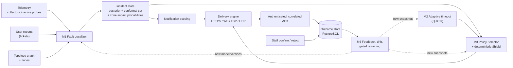
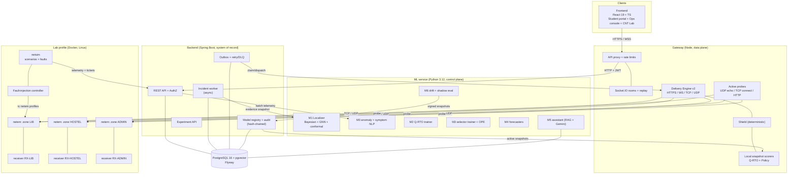
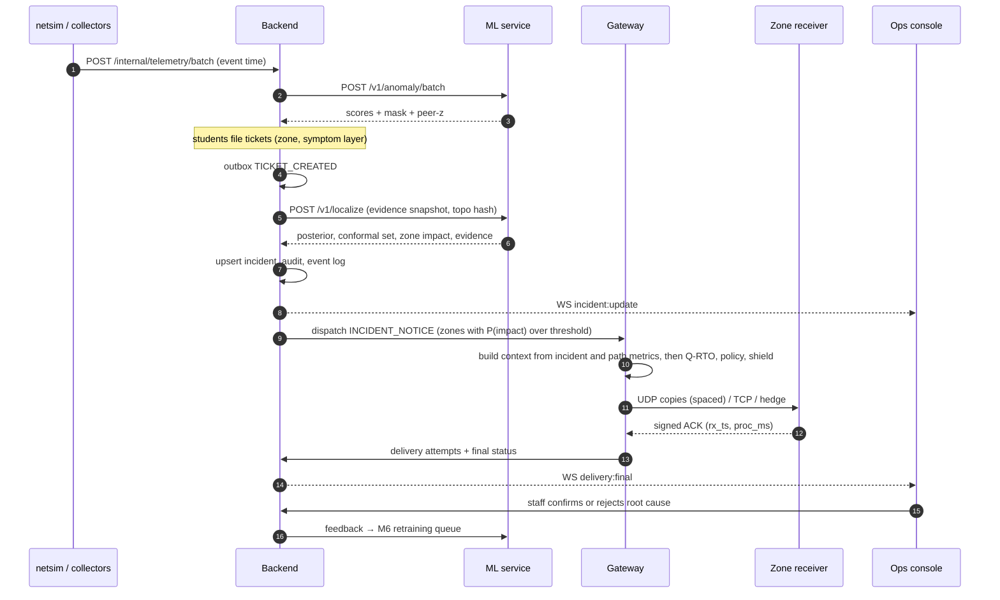
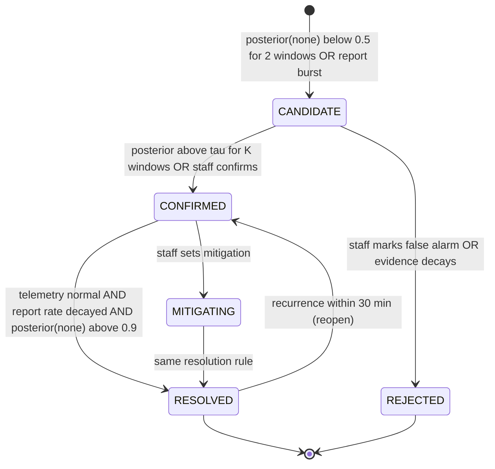
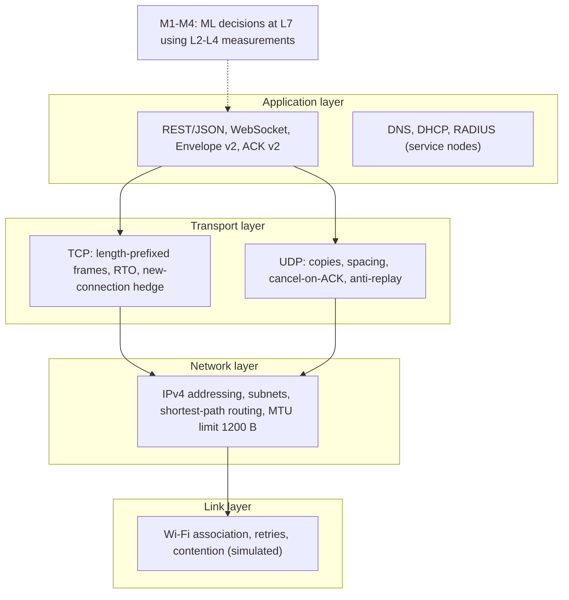
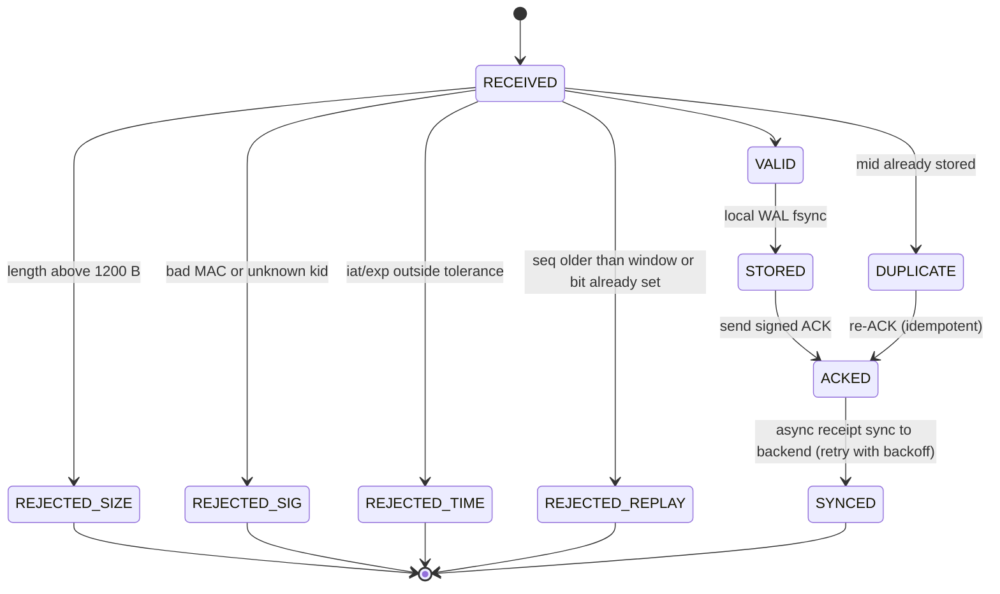
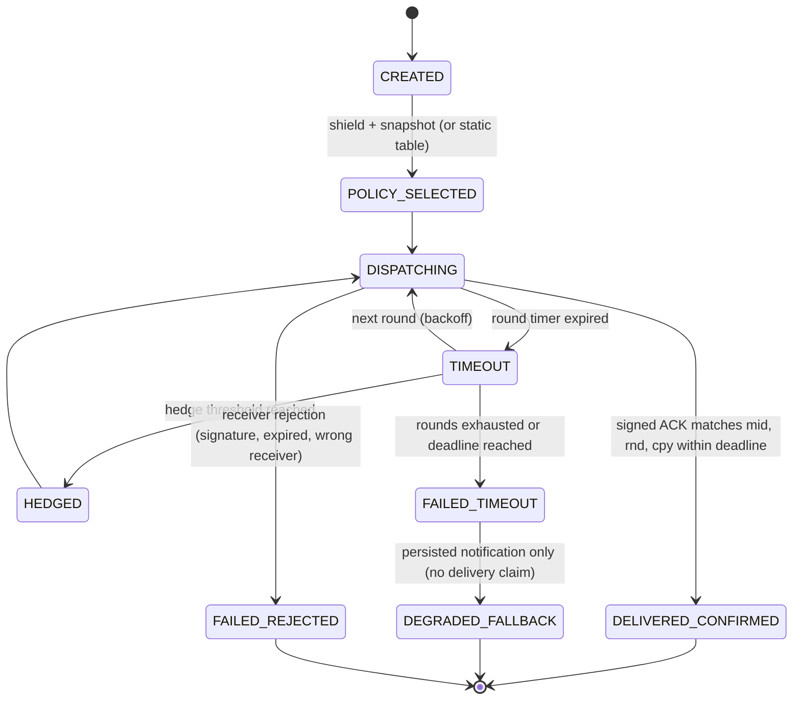
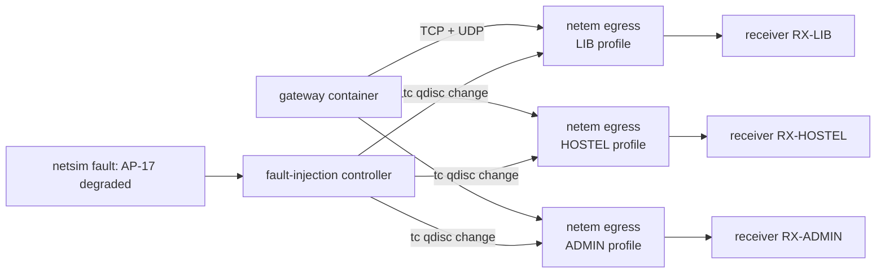
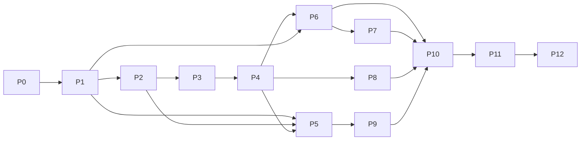

# CampusConnect v2 — Network-Aware Closed-Loop Intelligence

**Build specification, research plan and patent-evidence guide**

| | |
|---|---|
| **Document status** | Authoritative build spec for the v2 upgrade (supersedes `CampusConnect_FINAL_IMPLEMENTATION_PLAN.md` where they differ) |
| **Spec date** | 2026-11-07 |
| **Baseline** | `CampusConnect_full_package.zip` (Spring Boot + Node gateway/receiver + FastAPI ML prototype + React) |
| **Primary audience** | An AI coding agent (or human developer) that will build v2 end to end |
| **Secondary audience** | Project team, course examiners, paper reviewers, patent counsel |
| **Course context** | Computer Networks & Telecommunications (CNT) course project, with a research paper and patent filing as goals |

> **Honesty rules that apply to everything below.** (1) This project is a prototype and research testbed, not a production campus system and not an emergency service. (2) Nothing here guarantees patentability or publication; novelty must be established by a formal prior-art search and by *measured* results. (3) No number, accuracy figure, or "improvement" may appear in the paper, patent, or UI unless it was produced by a reproducible run stored under `experiments/runs/`. (4) Where this spec says *"not verified by execution"*, the statement comes from reading code, not running it.

---

## Table of contents

0. [How to use this document (read first)](#0-how-to-use-this-document-read-first)
1. [Executive summary](#1-executive-summary)
2. [Baseline audit — what exists, what is wrong](#2-baseline-audit--what-exists-what-is-wrong)
3. [Change plan — KEEP / CHANGE / ADD / REMOVE](#3-change-plan--keep--change--add--remove)
4. [Target architecture](#4-target-architecture)
5. [The innovations — ML module specifications (M0–M6)](#5-the-innovations--ml-module-specifications-m0m6)
6. [CNT topic coverage and the Visual Lab](#6-cnt-topic-coverage-and-the-visual-lab)
7. [Protocol v2 and the delivery engine](#7-protocol-v2-and-the-delivery-engine)
8. [Data model (Flyway V7+)](#8-data-model-flyway-v7)
9. [API contracts](#9-api-contracts)
10. [Simulator, emulator and datasets](#10-simulator-emulator-and-datasets)
11. [AI / LLM integration](#11-ai--llm-integration)
12. [Frontend design and screens](#12-frontend-design-and-screens)
13. [Security and privacy](#13-security-and-privacy)
14. [Testing and quality gates](#14-testing-and-quality-gates)
15. [Experiments and the research paper](#15-experiments-and-the-research-paper)
16. [Patent dossier guidance](#16-patent-dossier-guidance)
17. [Build plan — phases, tasks, exit criteria](#17-build-plan--phases-tasks-exit-criteria)
18. [Configuration, run, and repository hygiene](#18-configuration-run-and-repository-hygiene)
19. [Appendices](#19-appendices)

---

## 0. How to use this document (read first)

### 0.1 Rules for the AI builder (non-negotiable)

1. **Three-layer decision separation.** *ML recommends* → *deterministic shield enforces* → *humans confirm consequential actions*. ML code MUST NOT be able to bypass authentication, signature checks, retry/copy caps, payload caps, or test-mode restrictions.
2. **Spring Boot remains the system of record** for users, tickets, incidents, delivery records, models and audit. The gateway transports; the ML service computes; neither owns durable truth.
3. **Never report delivery without an authenticated, correlated ACK.** "Socket send succeeded" ≠ "delivered". Preserve and strengthen this existing project rule.
4. **Control plane / data plane split.** Training, calibration and snapshot publication are asynchronous (control plane). Per-message decisions (timeout, policy) are computed **locally in the gateway from a signed snapshot** in < 5 ms and MUST NOT make a network call to the ML service on the hot path.
5. **Every ML capability ships with all of:** deterministic fallback, model version + checksum, explanation/evidence, unit tests, evaluation script, kill-switch (config flag), and an entry in the model registry.
6. **Additive migrations only.** Never edit Flyway `V1`–`V6`. New work starts at `V7`.
7. **No fabricated results.** Dataset generators, experiments and figures are code; numbers in docs are generated from run artifacts.
8. **No secrets in the repository.** Fix `.env.example` first (finding S-01).
9. **Small vertical slices.** A feature is *done* only when it satisfies the Definition of Done in §14.1.
10. **Cross-platform.** The team develops on Windows/PowerShell. All scripts MUST run via the `campusctl` Python CLI (§18.4) or documented PowerShell equivalents. Linux-only features (tc netem, pcap) run inside Docker containers.

### 0.2 Normative language

**MUST / MUST NOT / SHOULD / MAY** follow RFC 2119. Identifiers: `FR-*` functional requirement, `NFR-*` non-functional, `AT-*` acceptance test, `M*` ML module, `B/S/N/M/F/Q/R-*` audit finding, **T1/T2/T3** priority tiers (T1 = required for paper + patent evidence; T2 = strengthens claims; T3 = stretch).

### 0.3 Decisions already made (with rationale) and open decisions

| # | Decision | Rationale | Confirm? |
|---|---|---|---|
| D1 | Keep Java/Spring Boot backend and Node/TypeScript gateway + receiver | Working code, authoritative-backend rule, Node `net`/`dgram` suit the CNT demos | No |
| D2 | **Merge the Node `ai-service` into the Python ML service** (`assistant` package) | One fewer service/language; embeddings and RAG are easier in Python; closes the "browser can reach AI directly" gap | Yes — if the team prefers, keep Node AI service but add auth + gateway-only access |
| D3 | **Port `network-simulator` to Python** (`netsim`) | numpy/networkx shared with ML code; richer generators; feeds both dataset export and live replay | Yes |
| D4 | Add a Docker-based **netem emulation lab** for real TCP/UDP under controlled loss/delay | Userspace proxies cannot drop TCP packets; kernel `tc netem` is faithful | Yes — verify `tc` works in your Docker Desktop VM |
| D5 | Use **pgvector** for ticket/KB embeddings | Real vector search without another service | Yes — otherwise store embeddings in ML-service memory |
| D6 | GNN localizer (PyTorch, CPU) is **T2**; Bayesian localizer is **T1** | Interpretable baseline first; GNN only if it beats it on held-out scenarios | Yes |
| D7 | **Academics module is frozen and feature-flagged off** (`FEATURE_ACADEMICS=false`), excluded from research scope | Not related to CNT/ML contribution; reduces maintenance surface | Yes — delete entirely if unused in the demo |
| D8 | Rename "Emergency" to **Critical Notice Delivery (test mode)** everywhere in UI/code | Avoids implying a safety service | No |
| D9 | Receiver ACK semantics default to `LOCAL_DURABLE` (ack after local fsync; async sync to backend); `BACKEND_DURABLE` kept as an option and compared in experiments | Removes backend latency from ACK path; demonstrates the end-to-end argument | Yes |

### 0.4 Reading order

*AI builder:* §0 → §2 (so you do not re-introduce known defects) → §3 → §4 → the section for the phase you are building (§17 tells you which). *Examiner/reviewer:* §1 → §6 → §15. *Patent counsel:* §1 → §5 → §16 → §15.

---

## 1. Executive summary

### 1.1 What CampusConnect is today

A campus-support portal (tickets, notifications, knowledge assistant) built as a service-oriented monorepo that doubles as a CNT teaching system: HTTP/REST through a gateway, WebSockets, a TCP event channel with application ACKs, a UDP datagram test channel with HMAC-signed envelopes, a durable outbox, a network topology seed, and an early ML/incident prototype.

### 1.2 The problem the v2 upgrade addresses

Campus Wi-Fi/network faults are *observed by two noisy, incomplete sensor types*: **infrastructure telemetry** (dense but sometimes missing — an access point that is down cannot report that it is down) and **human reports** (sparse, delayed, mislocated, but present exactly where users are hurting). Existing support tools treat tickets as isolated records, and fixed transport settings treat every notification the same regardless of how bad the network and the incident are.

### 1.3 The v2 thesis

> **A closed loop in which (1) user reports and telemetry are fused over the network topology to infer a *calibrated* fault hypothesis, (2) that inferred incident state conditions a *safety-shielded, learned* delivery policy and a *learned* acknowledgment timeout, and (3) delivery outcomes and staff corrections flow back to improve all three — evaluated under controlled, reproducible network impairment.**



### 1.4 Innovation map

| ID | Module | CNT topic it serves | ML technique | Strongest baseline(s) | Headline metric | Tier |
|---|---|---|---|---|---|---|
| **M0** | Telemetry anomaly + report understanding | Network management, OSI-layer diagnosis | Peer-relative anomaly model; text → symptom-layer classifier | Static thresholds; TF-IDF+LR | PR-AUC, detection delay, macro-F1 | T1 |
| **M1** | **Fault Localizer** (report + telemetry + topology fusion; informative-missingness; conformal sets; zone-impact marginals) | Network topology, fault management, DNS/DHCP/Wi-Fi dependencies | Bayesian graph posterior (T1) → GNN (T2); split-conformal sets | Telemetry-only; ticket-only clustering; hop-distance heuristic | Top-1/Top-3/MRR vs % telemetry-blind nodes; time-to-localize; set coverage | **T1** |
| **M2** | **Q-RTO** — incident-conditioned quantile ACK timeout | Reliable transfer, ARQ, RTO (RFC 6298), Karn's algorithm | Quantile GBDT + conformalized quantile regression | RFC 6298 SRTT/RTTVAR; fixed 500 ms; empirical p95 | Spurious-timeout rate vs recovery delay (Pareto) | T1 |
| **M3** | **Policy Selector + Shield** — deadline-aware choice of transport, copies, spacing, hedging | TCP vs UDP, loss/burst behaviour, redundancy, hedging, FEC | Contextual bandit (LinUCB / GBDT utility) + off-policy evaluation; deterministic safety shield | Fixed TCP; fixed UDP×4; static rule table; hindsight-best fixed | On-time delivery @ bandwidth overhead; p99 latency | **T1** |
| **M4** | Propagation / path-quality forecaster | Congestion, cascading overload, queueing | GBDT hazard model on graph features; short-horizon smoothing/GBDT forecast | Hop-distance heuristic; current `anomaly×0.8` rule | AUPRC, Brier, calibration | T2 |
| **M5** | Grounded LLM assistant (RAG, guided report, incident narrator) | Application layer, service desk UX | Hybrid retrieval + schema-constrained Gemini generation + faithfulness checks | Keyword retrieval (current) | Citation precision, abstention quality, structured-extraction F1 | T2 |
| **M6** | Feedback, drift, gated model lifecycle | Network operations (NOC) practice | Shadow evaluation, PSI/KS/ADWIN drift, human-gated promotion | None (process contribution) | Promotion safety (no regressions), hash-chained audit | T2 |

### 1.5 What is *not* being claimed

* Not "first ever" anything. Bayesian fault localization over topologies, contextual-bandit protocol selection, deadline-aware redundancy bandits, conformal root-cause analysis and learned RTOs all have prior art (§16.2). The defensible contribution is the **specific integration** — report-aware localization with informative missingness → calibrated incident state → shielded delivery policy and timeout → feedback — *and its measured technical effect*.
* Not a real emergency system. Critical delivery is a **test-mode protocol study**.
* Not validated on a real campus. Evaluation uses a calibrated synthetic generator plus controlled real-socket emulation; real telemetry is an optional adapter (§10.7).

### 1.6 Deliverables of the finished project

1. Running system (docker compose `core` + `lab` profiles) with the final demo script (§17.7).
2. Versioned synthetic datasets + generators + frozen test seeds (§10.5).
3. Trained, calibrated, registered models with evaluation reports (§5, §15).
4. Reproducible experiment suite producing every table/figure (§15).
5. CNT Visual Lab (§6).
6. Paper draft and patent invention-disclosure dossier (§15, §16).

---

## 2. Baseline audit — what exists, what is wrong

Audit method: every source file in the package was read; claims below cite file paths. Items marked **(not verified by execution)** were found by tracing code; the builder MUST reproduce them with a failing test before fixing.

### 2.1 Inventory

| Component | Size (approx.) | State |
|---|---|---|
| `backend` (Spring Boot 3.5, Java 21) | ~3.5k LOC, 6 Flyway migrations, 3 test classes | Auth/tickets/notifications solid; incident/telemetry/outbox/delivery services have **no tests** |
| `gateway` (Node/Express 5/Socket.IO) | ~0.9k LOC, 2 test files | Proxy, WS auth, TCP/UDP senders, outbox dispatcher work; policy is effectively fixed |
| `emergency-receiver` (Node `net`/`dgram`) | ~0.3k LOC, 1 test file | HMAC envelope validation, backend-persisted receipts |
| `ml-service` (FastAPI) | ~0.3k LOC, 3 tests | **Hand-weighted formulas**; one training script (anomaly); `models/` empty |
| `network-simulator` (TS) | ~80 dense LOC, 1 test file | 7 nodes, 1 building, writes files only, no live feed |
| `ai-service` (Node/Express) | ~0.2k LOC | Keyword retrieval + optional Gemini; permissive CORS; no auth |
| `frontend` (React 19, Vite 7, Tailwind 4) | ~3.5k LOC (0.9k is legacy `main.tsx`) | Works; polling dashboards; no charts/graph; no tests |
| CI | **none** (`.github/` contains only tool-residue hooks) | README mentions CI files that do not exist |
| Compose | PostgreSQL only | No images for other services |

### 2.2 What is good and MUST be preserved

* Clear service boundaries and the "backend owns truth" rule.
* Transactional **outbox** with `FOR UPDATE SKIP LOCKED` claiming and lease recovery (`OutboxService`).
* Idempotent receipts (`tcp_event_receipts`, `emergency_receipts`) and ACK-after-persist discipline.
* HMAC envelope with expiry/nonce/sequence concepts; constant-time token compare (`MessageDigest.isEqual`).
* WebSocket JWT handshake with backend-checked ticket room joins.
* Honest labelling of heuristic vs trained outputs (`mode: heuristic-fallback`), scenario-level (not row-level) train/test split.
* Correlation IDs and bounded, role-gated event timeline.

### 2.3 Findings

**Severity:** C = critical (breaks a core claim or leaks a secret), H = high, M = medium, L = low.

| ID | Sev | Finding | Evidence | Fix |
|---|---|---|---|---|
| **B-01** | **C** | **Emergency/critical UDP confirmation likely can never succeed *(not verified by execution)*.** `ReceiverSequenceService.next()` *increments and stores* `last_sequence` when the gateway requests a sequence; later `DeliveryRecordService.recordEmergencyReceipt()` only accepts a receipt when `last_sequence < incoming` — but the incoming value equals the already-stored value, the upsert updates 0 rows, and the method throws "stale or already used". The receiver therefore never ACKs. | `backend/.../ReceiverSequenceService.java`, `DeliveryRecordService.java`, `gateway/src/index.ts` (`getNextEmergencySequence`) | §7.5 (sender-side sequence + receiver anti-replay window) ; write the failing integration test first |
| **S-01** | **C** | `.env.example` contains a **non-placeholder-looking Gemini API key** and a weak bootstrap admin password. Treat the key as leaked: revoke/rotate it; never commit credentials; template values must be obviously fake. | `.env.example` (do **not** copy the value anywhere) | §13.2, §18.2 |
| S-02 | H | JWT secret has a hard-coded development fallback in both backend (`application.yml`) and gateway (`index.ts`); if env is missing, tokens are forgeable by anyone who read the repo. | `application.yml`, `gateway/src/index.ts` | Fail-fast outside `dev` profile (§13.2) |
| S-03 | H | HMAC canonical string omits `version` and `type`; signature does not cover the message type (type-confusion/downgrade risk). | `gateway/src/transport.ts` `signatureFor`, `emergency-receiver/src/security.ts` `canonical` | §7.3 (sign full envelope, canonical JSON per RFC 8785) |
| S-04 | H | **ACKs are unauthenticated** JSON; a path attacker can forge "DELIVERED_CONFIRMED". | `transport.ts` `validAck`, receiver `udpSocket.send(ack)` | §7.3 (HMAC-signed ACK, key id, replay-proof via `mid`+`rnd`+`cpy`) |
| S-05 | M | Strictly monotonic sequence rule rejects legitimate **reordered** datagrams. | `recordEmergencyReceipt` | §7.4 sliding anti-replay window (cf. RFC 4303 section 3.4.3 concept) |
| S-06 | M | AI service listens with a CORS allowlist, **no authentication**, reachable without the gateway. | `ai-service/src/index.ts` | D2: merge into ML service, bind to internal network, internal token |
| S-07 | M | Live WebSockets are not re-validated after token expiry; no per-socket rate limits; no heartbeat tuning. | `gateway/src/index.ts` | §9.5 |
| N-01 | H | UDP envelope cap is 4096 B (> typical 1500 B path MTU) → IP fragmentation, higher loss amplification. | `transport.ts`, receiver `index.ts` | §7.2 (≤ 1200 B datagrams) |
| N-02 | H | "copies" are actually **sequential retries**: a fresh socket per attempt, each waits for its own ACK timeout. There is no real redundancy, spacing or cancel-on-ACK. | `transport.ts` `sendEmergencyDatagram` | §7.6 |
| N-03 | H | The "adaptive policy" is not adaptive: ML endpoint returns UDP for critical regardless of conditions; gateway ignores `recommendedPolicy`; the ML HTTP call sits **on the delivery hot path** (adds up to 1.5 s). | `gateway/src/index.ts` `scorePolicy`, `ml-service/src/main.py` `policy_score` | M3 (§5.4), rule 4 in §0.1 |
| N-04 | M | TCP framing decodes `chunk.toString("utf8")` per chunk — multi-byte characters split across chunks are corrupted. Byte-stream vs character semantics is a CNT teaching point *and* a bug. | `transport.ts`, receiver `index.ts` | §7.2 (length-prefixed binary frames, accumulate `Buffer`) |
| N-05 | M | Fixed 500 ms ACK timeout, 2 tries, no RTT estimation or backoff. | `sendTicketEvent` | M2 (§5.3) |
| N-06 | M | Sockets bind `127.0.0.1` only; cannot run receivers on other hosts/containers. | `transport.ts`, receiver | §7.7 config |
| N-07 | M | Expiry/issued-at checks depend on wall-clock agreement within seconds across hosts; no offset estimation. | receiver `security.ts` | §7.4 NTP-style 4-timestamp offset estimate |
| N-08 | M | `delivery_events.attempt BETWEEN 1 AND 5` + unique `(message_id, attempt, transport, event_type)` cannot represent parallel copies/rounds or store the policy decision. | `V3__network_incidents_delivery.sql` | §8 (`delivery_messages`, `delivery_attempts`, `policy_decisions`) |
| N-09 | M | WebSocket has no replay cursor or `incident:*` rooms; admin dashboards **poll every 10 s**. | `gateway/src/index.ts`, `AdminPages.tsx` | §9.5, §12 |
| M-01 | **H** | **The ML is not ML.** All endpoints except anomaly are hand-set weighted sums; there is one training script; no `datasets/`, no `models/` artifacts, no registry usage. Paper/patent claims of "ML-based" would currently be unsupported. | `ml-service/src/main.py`, `training/`, `README` | §5 |
| M-02 | H | Simulator is too thin to train or evaluate anything: 7 nodes in one building, one ticket per affected node, 1-minute steps, no Wi-Fi/DNS/DHCP features, trivial anomaly labels (label = "node is in affected set"), writes files only (no live feed to backend). | `network-simulator/src/*` | §10 |
| M-03 | **H** | `IncidentService.correlateTicket` runs **inside the ticket-creation DB transaction**, makes up to *N* synchronous HTTP calls to the ML service (one per candidate incident, 1.2 s timeout each), only handles `IT_NETWORK`, matches location by SQL `LIKE` on building/room names, and creates a new incident for every unmatched ticket. | `IncidentService.java`, `TicketService.java` | §5.2.7 (async worker), §10.3 (gazetteer) |
| M-04 | M | Placeholder features are fed to ML: `tickets5m = 1`, `connectionFailures = 0`, constants. | `IncidentService.networkFeatures`, `TelemetryService.record` | §5.2 |
| M-05 | M | Scoring logic is duplicated in Java (`latestNodeAnomaly`, `jaccard`, blends like `max(score, ml×0.85)`) and Python → drift and untestable blending. | `IncidentService.java`, `main.py` | Java MUST NOT compute scores; ML service is the single source |
| M-06 | M | Telemetry ingest calls ML synchronously **per row**, requires staff auth, and rejects timestamps older than 24 h → cannot replay simulated time or batch-ingest. | `TelemetryService.record` | §9.2 batch ingest + `run_id` |
| M-07 | L | Topology seed (7 nodes) differs from simulator topology (`RTR-01–GW-01` vs `CORE-01–GW-01`). | `V3` seed vs `topology.ts` | §10.1 single generated source of truth |
| M-08 | M | `model_versions` and `audit_events` tables exist but **no code uses them**; no feedback capture. | grep over `backend/src/main/java` | §8, §5.7 |
| M-09 | M | Isolation Forest is trained on rows that include anomalies with `contamination="auto"` and default `predict==-1` thresholding; training CLI points at a non-existent `../datasets/research`. | `train_anomaly.py` | §5.1 |
| F-01 | M | Legacy `main.tsx` (903 lines), `styles.css`, `reconstructed.html`, duplicate "reconstructed" entry points; `AdminPages.tsx` monolith; Tailwind and legacy CSS mixed; no frontend tests. | `frontend/` | §3.4, §12 |
| Q-01 | H | No CI. Backend tests cover only 3 classes; none for incident/telemetry/outbox/delivery; no E2E; no failure-injection tests. | repo tree | §14 |
| Q-02 | M | Compose contains only PostgreSQL; no container images for gateway/backend/receiver/frontend. | `docker-compose.yml` | §18.1 |
| R-01 | L | README embeds a long "critical assessment" and stale statements; `docs/` partly stale ("first implementation phase"); `.github/modernize/**` is tool residue; root `package-lock.json` is empty (`name: "final"`). | repo tree | §3.4 |
| R-02 | L | Gemini model id in `.env.example` (`gemini-3.8-flash`) is unverified; the service silently degrades if wrong. | `.env.example`, `ai-service` | §11.6 startup self-check |

### 2.4 Readiness scorecard against the v2 claims

| Claim the paper/patent needs | Current evidence | Gap |
|---|---|---|
| Learned fault localization beats baselines | None (formulas only) | Entire M1 + dataset + evaluation |
| Learned timeouts beat RFC 6298 | None (fixed 500 ms) | M2 + emulation lab |
| Adaptive policy beats fixed policies | None (policy effectively constant) | M3 + shield + OPE + emulation lab |
| Calibrated uncertainty | None | Conformal layer |
| Closed-loop improvement | Tables exist, unused | M6 |
| Reproducible experiments | Seeded simulator exists; nothing else | §15 |
| Confirmed-delivery integrity | Intent present; B-01/S-03/S-04 undermine it | §7 |


---

## 3. Change plan — KEEP / CHANGE / ADD / REMOVE

### 3.1 KEEP (do not rewrite; extend)

| Area | Keep | Notes |
|---|---|---|
| Auth & users | Registration (institutional domains), JWT, BCrypt, roles `STUDENT/STAFF/ADMIN`, admin bootstrap | Add email verification (T3) |
| Tickets | CRUD, messages, notifications, ownership rules | Extend with zone/symptom fields (§8) |
| Outbox pattern | `outbox_events`, claim/dispatch, lease recovery | Add exponential backoff + jitter + dead-letter (§8) |
| Receipts | `tcp_event_receipts`, `emergency_receipts` concepts | Rename/extend (§7) |
| Gateway | API proxy, JWT-verified Socket.IO, role-gated ops endpoints, correlation IDs, trace store | Harden (§9.5, §13) |
| Frontend shell | React 19 + Vite + Tailwind 4 + React Router; student pages | Re-skin per §12; keep routes working during migration |
| Knowledge base | Markdown articles under `knowledge-base/` | Becomes the RAG corpus (§11) |
| Honesty labels | `mode: heuristic-fallback / trained-artifact`, "test only" banners | Extend to every model response |

### 3.2 CHANGE (existing behaviour that must be redesigned)

| # | Change | Why (finding) | Spec |
|---|---|---|---|
| C1 | Incident correlation moves **out of the ticket transaction** into an async *incident worker* that consumes a `TICKET_CREATED` outbox event and calls the localizer **once per evidence snapshot** | M-03 | §5.2.7 |
| C2 | Replace string-`LIKE` location matching with a **campus gazetteer** (zones ↔ APs) and confidence-scored location resolution | M-03 | §10.3 |
| C3 | Telemetry ingest becomes **batch + async scoring** with `run_id` and event-time semantics | M-06 | §9.2 |
| C4 | Replace the sequence service with **sender-owned sequence + receiver sliding anti-replay window** | B-01, S-05 | §7.4 |
| C5 | **Sign ACKs**, sign the *whole* envelope, canonical JSON, key ids, ≤ 1200 B datagrams | S-03, S-04, N-01 | §7.2–7.3 |
| C6 | Replace "copies as sequential retries" with **scheduled copies with spacing, cancel-on-ACK, rounds, hedging** | N-02 | §7.6 |
| C7 | Replace fixed 500 ms timeout with **Q-RTO** (with RFC 6298 as fallback and baseline) | N-05 | §5.3 |
| C8 | Move policy decisions to **local snapshot scoring in the gateway**; ML service only trains/publishes | N-03 | §5.4, §7.8 |
| C9 | Replace `delivery_events` with `delivery_messages / delivery_attempts / policy_decisions` (keep old table read-only for history) | N-08 | §8 |
| C10 | Length-prefixed binary TCP frames with `Buffer` accumulation | N-04 | §7.2 |
| C11 | WebSocket: rooms `ops`, `incident:{id}`, `ticket:{id}`, `user:{id}`, `lab:{sid}`; replay cursor; token-expiry enforcement; admin dashboards switch from polling to WS + cache invalidation | N-09, S-07 | §9.5, §12 |
| C12 | Topology: one generated source of truth (YAML → SQL seed + simulator + ML graph); ≥ 80 nodes, zones, subnets | M-07 | §10.1 |
| C13 | Rename **Emergency → Critical Notice Delivery (test mode)** in UI, routes (`/ops/delivery`), code, docs | D8 | — |
| C14 | README slimmed to a user README; assessment content moves to `docs/` | R-01 | §18.5 |
| C15 | Ticket creation form → **guided report wizard** (LLM-assisted, schema-validated, user-confirmed) | UX + better features for M1 | §11.3, §12 |

### 3.3 ADD (new capability)

| FR | Capability | Tier | Spec |
|---|---|---|---|
| FR-LOC-1 | **Fault Localizer** service: posterior over node-fault hypotheses from telemetry + reports + topology; informative-missingness; evidence decomposition | T1 | §5.2 |
| FR-LOC-2 | **Conformal root-cause sets** + "needs human review" gating | T1 | §5.2.5 |
| FR-LOC-3 | **Zone-impact marginals** `P(zone impacted)` and uncertainty-aware **notification scoping** | T1 | §5.2.6 |
| FR-LOC-4 | GNN localizer variant + comparison harness | T2 | §5.2.8 |
| FR-LOC-5 | Incident lifecycle (candidate → confirmed → mitigating → resolved/rejected), merge/split suggestions, staff feedback | T1 | §5.2.7 |
| FR-TEL-1 | Peer-relative anomaly model, per-node-type normalisation, benign-surge handling | T1 | §5.1 |
| FR-TEL-2 | **Active probes** (UDP echo, TCP connect, HTTP TTFB) from the gateway with RFC 3550 jitter, loss, reorder, burst-length estimates → `path_metrics` | T1 | §7.9 |
| FR-DEL-1 | Delivery Engine v2 (HTTPS, WS, TCP+ACK, UDP+ACK with scheduled copies, hedged fallback) | T1 | §7 |
| FR-DEL-2 | **Q-RTO** adaptive timeout + snapshot publication | T1 | §5.3 |
| FR-DEL-3 | **Policy Selector + Shield**, decision log with counterfactual utilities | T1 | §5.4 |
| FR-DEL-4 | Off-policy evaluation (IPS/SNIPS/DR) service | T2 | §5.4.6 |
| FR-DEL-5 | Receiver anti-replay window, local durable ACK mode, multi-receiver zones | T1 | §7.4 |
| FR-DEL-6 | Optional FEC (XOR parity) for multi-chunk messages | T3 | §7.6 |
| FR-PRED-1 | Propagation forecaster | T2 | §5.5 |
| FR-PRED-2 | Short-horizon path-quality forecaster feeding M3 context | T3 | §5.5 |
| FR-LAB-1 | **netem emulation lab** (3 zone receivers behind kernel netem; Gilbert–Elliott loss) | T1 | §10.4 |
| FR-LAB-2 | **Fault-injection controller** mapping simulated node faults to netem profiles (couples simulation ↔ real sockets) | T1 | §10.4 |
| FR-LAB-3 | Discrete-event simulator (DES) for large sweeps, validated against real-socket runs | T1 | §10.6 |
| FR-LAB-4 | pcap capture + "Wireshark-lite" panel | T3 | §6.4 |
| FR-AI-1 | RAG assistant with hybrid retrieval, citations, abstention | T2 | §11.2 |
| FR-AI-2 | Guided report extraction (LLM → JSON schema → user confirm) | T2 | §11.3 |
| FR-AI-3 | Incident narrator with number-grounding verifier | T2 | §11.4 |
| FR-UI-1 | Ops console (incident detail, topology heatmap, delivery waterfall, model registry, experiment viewer) | T1 | §12 |
| FR-UI-2 | **CNT Visual Lab** (≥ 10 interactive topic modules) | T1 | §6 |
| FR-UI-3 | Student "Is it just me?" status page + ticket-linked incident banner | T2 | §12.6 |
| FR-UI-4 | Evidence Mode (step-through + signed export bundle) | T1 | §16.5 |
| FR-OPS-1 | `campusctl` CLI, CI pipeline, compose profiles, Testcontainers integration tests | T1 | §14, §18 |
| FR-OPS-2 | Hash-chained audit log; model registry with gated promotion | T1 | §5.7 |

### 3.4 REMOVE (delete or disable)

| # | Remove | Action |
|---|---|---|
| X1 | `frontend/src/main.tsx` (legacy, 903 lines), `frontend/src/styles.css`, `frontend/reconstructed.html`, `frontend/tsconfig.reconstructed.json` | Delete. Rename `main.reconstructed.tsx → main.tsx`, `AppReconstructed.tsx → App.tsx`, update `index.html` |
| X2 | `.github/modernize/**` | Delete (tool residue). Replace with real workflows (§14.6) |
| X3 | Root `package-lock.json` (empty, `name: "final"`) | Delete (or adopt npm workspaces, then regenerate) |
| X4 | Node `ai-service/` | After D2 merge is verified: delete; its knowledge/KB loader moves into `ml-service/src/assistant/` |
| X5 | Java-side scoring helpers (`latestNodeAnomaly`, `jaccard`, `networkFeatures` placeholders, `max(score, ml×0.85)` blend) | Delete; Java sends raw evidence, ML service scores |
| X6 | Sequential-retry "copies" loop in `sendEmergencyDatagram` | Replace (C6) |
| X7 | `deterministic-critical-v1` hard-coded policy string and the in-hot-path ML call | Replace (C8) |
| X8 | Server-sequence endpoint `/internal/receiver-sequences/{id}/next` | Remove after C4 |
| X9 | Admin-page 10 s polling timers | Replace with WS + TanStack Query invalidation |
| X10 | Academics module surface (V4 tables stay in history; controllers/UI behind `FEATURE_ACADEMICS=false`; **excluded from tests, docs and paper**) | Flag off; delete outright before final submission if not demoed |
| X11 | Real-looking secrets and weak defaults in `.env.example` | Replace with `CHANGE_ME_*` placeholders; add secret scanning (§13.2) |
| X12 | "Critical assessment" and roadmap prose inside `README.md` | Move to `docs/assessment.md` (this document supersedes) |

---

## 4. Target architecture

### 4.1 Component view



### 4.2 Control plane vs data plane (why it matters for CNT and for the patent narrative)

| Plane | Components | Rules |
|---|---|---|
| **Data plane** (per-message, latency-critical) | Gateway Delivery Engine, Shield, snapshot scorers, receivers, probes | No synchronous calls to ML/backend for decisions; < 5 ms decision budget; deterministic fallback table always loaded |
| **Control plane** (periodic, compute-heavy) | ML training, calibration, OPE, drift checks, snapshot signing, incident worker | Asynchronous; failure never blocks delivery; produces **signed snapshots** the gateway verifies and hot-swaps |
| **Management plane** | Backend, registry, audit, UI | Human approvals, promotions, parameter changes (all audited) |

This mirrors SDN-style separation and gives a clean technical argument: *the learned controller cannot add latency to the thing it is optimising.*

### 4.3 Services, ports, responsibilities

| Service | Port(s) | Language | Responsibility |
|---|---|---|---|
| `frontend` | 5173 | TS/React | UI; no secrets; no authorization decisions |
| `gateway` | 3001 (HTTP/WS) | TS/Node 22 | Proxy, WS, delivery engine, shield, probes, snapshot scorers |
| `backend` | 8080 | Java 21 | System of record, authZ, incident worker, outbox, registry, audit |
| `ml-service` | 5100 | Python 3.12 | M0–M6 compute and training APIs; assistant (D2) |
| `receiver` (×3 in lab) | UDP 41234 / TCP 41235 / health 4001 (per container) | TS/Node | UDP+TCP receivers, anti-replay, ACK signing, local WAL |
| `netsim` | 5200 (control API) | Python | Scenario engine, ticket generator, dataset export, live replay |
| `netem` sidecars | n/a | iproute2 | Kernel impairment on receiver/gateway interfaces |
| `postgres` | 5432 | — | `pgvector/pgvector:pg16` image |

### 4.4 Technology choices

| Area | Choice | Notes |
|---|---|---|
| Backend | Spring Boot 3.5, Java 21, Flyway, JdbcTemplate repos, Micrometer + Prometheus, Testcontainers | Keep existing style; move SQL into repository classes |
| Gateway/receiver | Node 22 LTS, TypeScript 5, `zod`, `pino`, `prom-client`, `helmet`, `express-rate-limit`, `undici`, `better-sqlite3` (receiver WAL) | Test: Vitest or `node:test` (keep existing) |
| ML | Python 3.12, FastAPI, pydantic v2, numpy, pandas, pyarrow, scikit-learn, LightGBM (quantile/GBDT), networkx, scipy, joblib, `rapidfuzz`, optional PyTorch CPU (GNN), optional `sentence-transformers`, structlog; dev: pytest, hypothesis, ruff, mypy | Hand-roll conformal (tiny, auditable); avoid heavy MLOps stacks |
| Frontend | React 19, Vite 7, Tailwind 4, React Router 7, TanStack Query, Zustand, zod, `@xyflow/react` + dagre, Recharts (or visx), framer-motion, i18next, Vitest + Testing Library + MSW, Playwright, axe-core | Keep Lucide icons |
| Data | PostgreSQL 16 + pgvector; Parquet for datasets | No extra brokers/graph DBs |
| Ops | Docker Compose profiles; `campusctl` (Typer) ; GitHub Actions | |

### 4.5 Target repository layout

```text
CampusConnect/
├── README.md                     # this spec → later trimmed to a user README (see §18.5)
├── docker-compose.yml            # profiles: core | lab | full
├── .env.example                  # placeholders only
├── campusctl/                    # Python CLI: data, train, eval, exp, demo, lint
├── backend/                      # Spring Boot (packages: incident/ topology/ telemetry/ delivery/ model/ audit/ outbox/)
├── gateway/
│   └── src/ { index.ts, delivery/{engine,shield,schedule,hedge}.ts, snapshot/{verify,rto,policy}.ts,
│              probes/{udp-echo,tcp,http}.ts, protocol/{envelope,canonical,frame,replay}.ts, ws/{auth,rooms,replay}.ts }
├── receiver/                     # renamed from emergency-receiver
├── ml-service/
│   ├── src/ { api/, features/, models/, training/, inference/, graph/, evaluation/, assistant/, lifecycle/, snapshots/ }
│   ├── data/ (gitignored)  models/ (artifacts + checksums)  tests/
├── netsim/                       # Python simulator (replaces network-simulator/)
├── netem-lab/                    # Dockerfiles, tc scripts, fault-injection controller
├── frontend/
├── knowledge-base/
├── topology/campus.yaml          # single source of truth for the graph
├── experiments/ { configs/, runs/, results/, figures/, tables/ }
├── artifacts/ { datasets/, model-metrics/, evidence-bundles/ }
├── docs/ { architecture/, networking/, ml/, experiments/, patent/, development/, assessment.md }
└── .github/workflows/
```

### 4.6 Time model

All inference uses **event time** (`observed_at`, `reported_at`), never wall-clock ingestion time, so simulated 60× replays and real-time runs behave identically. Each simulation or experiment has a `run_id`; production-like data has `run_id = NULL`. Dashboards filter by run.

### 4.7 End-to-end sequence (one incident)



---

## 5. The innovations — ML module specifications (M0–M6)

### 5.0 Shared conventions for every ML module

**Response envelope** (all ML endpoints MUST return this shape; the backend persists it in `model_predictions`):

```json
{
  "model":   { "name": "localizer", "version": "loc-bayes-1.0.0", "checksum": "sha256:…",
               "mode": "trained-artifact | calibrated-bayes | heuristic-fallback" },
  "result":  { },
  "confidence": { "calibrated": true, "value": 0.91, "method": "temperature+conformal" },
  "evidence": [ { "kind": "telemetry|reports|topology|prior|missingness", "text": "…", "contribution": 3.1, "refs": ["AP-17"] } ],
  "warnings": [ "ood_feature:packetLoss" ],
  "generatedAt": "2026-11-07T09:21:10Z",
  "latencyMs": 42
}
```

**Rules.** (1) `mode` MUST say honestly whether a trained artifact was used. (2) Probabilities exposed to users MUST be calibrated or labelled "uncalibrated score". (3) Inputs are validated with strict schemas and size caps (extra fields forbidden). (4) Each module has a **registered fallback** (rule-based) and a config kill-switch `ML_<MODULE>_ENABLED`. (5) Random seeds are fixed and stored with each trained artifact. (6) Training scripts are `python -m src.training.train_<module>` and are driven by `campusctl train …`. (7) Evaluation is always scenario-level (never row-level) and uses the frozen split in §10.5.

**Model artifact layout:** `ml-service/models/<name>/<version>/{model.joblib|model.pt|snapshot.json, metadata.json, metrics.json, calibration.json, CHECKSUMS.sha256}`; `active` is a registry state, **not** a symlink the ML service can flip by itself (§5.7).

---

### 5.1 M0 — Telemetry anomaly model and report understanding (T1)

#### 5.1.1 Anomaly model

**Goal.** Produce, per node and per window, an anomaly score `a_v ∈ [0,1]`, a freshness mask `m_v ∈ {0,1}`, and a *peer-relative* score that suppresses benign load surges (exam day, flash crowds).

**Features (per node, windows of 1 min over 15-s polls):** node-type-specific raw metrics (§10.2) normalised per node type; EWMA and rolling std; delta vs previous window; **peer-relative z-score** = (x − median(peers)) / MAD(peers), where peers are siblings under the same parent (APs on the same switch, switches in the same building); time-of-day baseline residual (seasonal median by hour × weekday); `stale_seconds`; `collector_status`.

**Models (compare all; ship the best on validation PR-AUC):**
1. `rule-threshold` (current thresholds) — baseline.
2. `robust-z` — rolling baseline + peer z; no learning.
3. `iforest-normal` — Isolation Forest **trained on normal-only windows** per node type (fixes M-09), threshold chosen on validation by target FPR.
4. `gbdt-supervised` — LightGBM on labelled scenarios (labels from simulator ground truth with onset margins).
5. *(T3)* `lstm-ae` / TCN autoencoder.

**Outputs:** `a_v`, `isAnomaly`, top-3 contributing metrics (SHAP for GBDT or per-feature z for others), `peerRelative`, `mode`.

**Evaluation:** point-wise PR-AUC and F1; **event-level** detection delay (onset → first alert), false alarms per node-day, and false-alarm rate **on benign-surge scenarios**; robustness to sensor noise and to MCAR/MNAR missingness.

#### 5.1.2 Symptom-layer classifier (ticket text → OSI-layer symptom)

**Classes** (`symptom_layer`): `LINK` (cannot associate/connect to Wi-Fi), `NETWORK` (connected, no internet / no IP / 169.254.x.x), `DNS` (some names fail to resolve), `AUTH` (login/portal/RADIUS failures), `APP` (one service down, e.g. LMS), `PERF` (slow/lagging), `INTERMITTENT` (drops), `OTHER`.

**Compatibility matrix** `compat[symptom_layer][node_type]` ∈ [0,1], stored in `topology/campus.yaml` (e.g. `LINK×ACCESS_POINT = 1.0`, `NETWORK×DHCP = 1.0`, `DNS×DNS = 1.0`, `APP×SERVICE = 1.0`, `PERF×ACCESS_POINT = 0.6`, `PERF×UPLINK = 0.8`). This is how the localizer uses OSI-layer reasoning.

**Models:** (a) TF-IDF + logistic regression (baseline, always available offline); (b) multilingual sentence embeddings + logistic regression; (c) Gemini structured extraction (§11.3) validated against the same schema, with (a) as fallback. **Languages:** English plus code-mixed Hinglish (e.g. "library me wifi nahi chal raha"); evaluate on a dedicated Hinglish/typo test set.

**Outputs:** `layerProbs` (calibrated), `scope` ∈ {`ME_ONLY`,`MANY`,`UNKNOWN`}, `deviceHint`, extracted location mentions. **Metric:** macro-F1, calibration (ECE), per-language F1.

---

### 5.2 M1 — Fault Localizer (T1; the main research contribution)

#### 5.2.1 Problem statement

Given a topology graph, per-node telemetry (possibly missing), and a stream of user reports with locations and symptoms, infer *which node(s) are faulty*, *which zones are impacted*, and *how certain we are* — early, and robustly when telemetry is missing.

**Key idea (informative missingness).** If a switch dies, the APs below it usually stop reporting telemetry *and* their users start filing tickets. Treating missing telemetry as "no information" wastes the strongest clue. The localizer models **why telemetry is missing** (collector glitch vs. unreachable-because-upstream-failed) and lets *absence under a subtree* raise the posterior on the subtree root.

#### 5.2.2 Notation

```text
V      infrastructure + service nodes (CORE, RTR, FW, SW, AP, DNS, DHCP, RADIUS, SERVICE, GW)
Z      zones (rooms/areas); N_z = user population of zone z
H      hypothesis set = {∅} ∪ {v ∈ V_faultable}   (∅ = no fault)
I[h,z] ∈ [0,1]  impact of fault h on zone z (fraction of users whose service path is disrupted)
a_v    anomaly score (M0); m_v ∈ {0,1} telemetry observed in window; 
c_z(h) soft report count in zone z for hypothesis h (symptom-compatibility weighted)
s_v(h) ∈ {HEALTHY, FAULTY, IMPACTED}  state of node v if h is the fault
```

#### 5.2.3 Bayesian posterior (baseline; interpretable; T1)

```text
log p(h | E) = log π_h  +  LL_T(h)  +  LL_M(h)  +  LL_R(h)  −  log Z

LL_T(h) = Σ_v  m_v · log p( a_v | s_v(h), type(v) )          # Beta likelihoods per (state,type)
LL_M(h) = Σ_v  log p( m_v | s_v(h), type(v) )                # informative missingness:
              p(miss | HEALTHY)  = ε_c        (collector dropout, small)
              p(miss | FAULTY)   = q_f        (dead device often silent)
              p(miss | IMPACTED) = q_i(type)  (unreachable because upstream failed)
LL_R(h) = Σ_z  log NB( c_z(h) ; μ_z(h), φ )                  # Negative-Binomial for storms/clustering
              μ_z(h) = Δt · N_z · ( ρ_0 + (ρ_f − ρ_0) · I[h,z] · ramp(τ) )
              ramp(τ) = 1 − exp(−τ / τ_0)   # reporting delay after onset
```

* **Parameters** (`Beta(α,β)` per state×type, `ε_c, q_f, q_i, ρ_0, ρ_f, φ, τ_0`) are fitted by maximum likelihood on *training scenarios only* and stored in `calibration.json`. They are *learned*, not hand-set.
* **Prior** `π_h`: smoothed historical failure frequency by node type/age from `incidents`; `π_∅` high (default 0.9). Uniform fallback.
* **Efficient evaluation:** compute the all-healthy baseline once; for hypothesis `h` only nodes in `{h} ∪ Desc(h)` and zones with `I[h,z]>0` change state, so cost is `O(|Desc(h)| + |Z_h|)` per hypothesis.
* **Concurrent faults:** score all singles, take the top `m=8`, then score pairs among them (`k_max = 2` default). For disjoint impact sets use additivity: `LL(h₁∪h₂) ≈ LL(h₁)+LL(h₂)−LL(∅)`.
* **Redundancy:** dual-homed nodes use `I[h,z]` fractions (e.g. 0.2 residual impact when a redundant parent exists).
* **Soft locations:** a ticket's location resolves to a distribution `P(z | location_text)` (§10.3); `c_z(h) = Σ_t P(z|loc_t) · compat(symptom_t, type(h))`.

#### 5.2.4 Evidence decomposition (explainability)

For each top hypothesis return `{telemetry: Δ_T, missingness: Δ_M, reports: Δ_R, prior: Δ_π}` in nats relative to `∅`, plus human-readable strings, e.g.:

```text
AP-17  posterior 0.91
  + 9.4 nats from reports   (14 tickets in LIB-F2-East, expected 0.6)
  + 3.1 nats from telemetry (retry rate 6.2× peer median; neighbours healthy)
  + 0.0 nats from missingness (AP-17 reporting normally)
  − 0.4 nats prior
```

#### 5.2.5 Calibration and conformal root-cause sets

1. **Temperature scaling:** `p_cal(h) ∝ p(h)^{1/T}`; fit `T` on the *validation* scenarios by minimising NLL.
2. **Split conformal (LAC):** on *calibration* scenarios (separate from validation and test) compute nonconformity `s = 1 − p_cal(y_true | x)`; with `n` calibration instances, `q̂` = the `⌈(n+1)(1−α)⌉`-th smallest score; prediction set `C(x) = { v : 1 − p_cal(v|x) ≤ q̂ }`; default `α = 0.10`.
3. **Mondrian variant:** separate `q̂` per true node type (improves conditional coverage; evaluate as ablation).
4. **Guarantee and its limits:** marginal coverage ≥ `1−α` holds under exchangeability of calibration and test instances *within the generator distribution*. It is **not** guaranteed under distribution shift (new topology, new fault family) and for multi-fault ground truth the guarantee is per-fault; report empirical coverage under each. Never describe the guarantee more strongly than this.
5. **"Needs review" gate:** `|C(x)| > s_max (3)` **or** `p_cal(∅) ∈ [0.3, 0.7]` **or** entropy `> H_max` → mark `needsReview=true`; UI shows an amber banner and the delivery policy treats the incident as *uncertain* (§5.4 context).

#### 5.2.6 Zone-impact marginals and notification scoping (decision-theoretic coupling)

```text
P(z impacted | E) = Σ_{h ∈ H\{∅}} p_cal(h | E) · I[h,z]
Notify zone z  ⇔  P(z impacted) · C_miss(sev)  >  (1 − P(z impacted)) · C_unneeded
C_miss(sev) = C_0 · (1 + 4·sev)         # cost of not warning an affected zone
θ_scope(sev) = C_unneeded / (C_miss(sev) + C_unneeded)
```

Consequences: higher severity ⇒ lower threshold ⇒ wider scope; higher uncertainty ⇒ probability mass spreads over more candidate nodes ⇒ the union of plausibly affected zones is notified at lower confidence. **Metrics:** precision/recall/F2 of notified zones vs ground-truth impacted zones; users mis-notified per incident; reliability diagram of `P(z impacted)`. Cost constants live in `communication_params` (admin-editable, audited).

#### 5.2.7 Incident lifecycle and the async incident worker



**Worker algorithm** (`IncidentWorker`, every 15 s and on `TICKET_CREATED` outbox events, **never inside the ticket transaction**):

1. Build an *evidence snapshot*: telemetry last `W=10 min` (+masks), tickets in `W` with `{zoneDist, symptomProbs, t, userScope}`, open incidents, `topologyHash`.
2. Single call `POST /v1/localize` (timeout 3 s, circuit breaker). ML caches topology by hash (`PUT /v1/topology/{hash}`).
3. In **one DB transaction**: upsert incidents (identity = `Jaccard(impactedZones) ≥ 0.5` with an open incident **or** same top hypothesis), write `incident_hypotheses`, `incident_zone_impact`, ticket memberships (attach ticket if `P(z_t impacted) ≥ 0.5`, store responsibility and evidence), `incident_events`, `events_log` rows, `model_predictions`.
4. **Start-time estimate:** CUSUM on the top hypothesis subtree's anomaly and on the report rate; store `startedAtEstimate` with a bracket.
5. **Merge/split suggestions:** if two open incidents' top hypotheses share an ancestor with joint posterior higher than separate → *suggest merge*; if one incident's impacted-zone set splits into non-overlapping groups with distinct hypotheses → *suggest split*. Suggestions require staff confirmation.
6. **Fallback (ML down):** deterministic rule — ≥ 3 eligible tickets in one zone within 10 min → candidate incident with hypothesis = that zone's serving AP, `mode = rule-fallback`. Ticket creation is never blocked.

#### 5.2.8 GNN localizer (T2)

* **Graph:** nodes = `V`; edges = dependency (child↔parent, **two directed edge types**: up/down) + RF-adjacency (AP↔AP overlap).
* **Node features:** M0 anomaly + top metrics (z-scored by node type), `mask`, `stale_seconds`, subtree ticket counts (1/5/15 min) and rate-z, symptom-layer histogram, depth, degree, redundancy flag, historical failures.
* **Model:** 2–3 layers of direction-aware GraphSAGE (mean aggregation, separate weights per edge type), residual connections, per-node MLP head → logit per node; also a graph-level "any fault" logit. **Loss:** BCE with `pos_weight` or focal loss (class imbalance), multi-label for concurrent faults. **Training:** AdamW, early stopping on validation top-1, 5 seeds, report mean ± std.
* **Posterior:** softmax over nodes (+ ∅) → temperature scaling → same conformal layer as §5.2.5.
* **Stacking:** optional logistic stacker over `{Bayes log-post, GNN logit}`. Ship only if it beats §5.2.3 on **held-out scenarios** and **leave-one-fault-family-out** (§10.5).

#### 5.2.9 Baselines and ablations (all computed in `experiments/`)

| ID | Method | Purpose |
|---|---|---|
| L-B1 | Telemetry-only: argmax anomaly, move to lowest common ancestor when ≥ 60 % of siblings anomalous | strongest simple baseline |
| L-B2 | Ticket-only: cluster by zone/time, blame serving AP, escalate to common ancestor for adjacent zones | "classic ticket dedupe" baseline |
| L-B3 | Current repo heuristic (`0.55·anomaly + 0.45·centrality`) | show improvement over status quo |
| L-A1 | Bayes, telemetry term only | ablation |
| L-A2 | Bayes, reports term only | ablation |
| L-A3 | Bayes full, **missingness ignored** (treated MCAR) | isolates the informative-missingness contribution |
| L-F | Bayes full (proposed) | main method |
| L-G | GNN | T2 |
| L-S | Stack | T2 |

**Sweeps:** (i) *blind-spot sweep* — fraction of nodes with no telemetry `b ∈ {0,10,20,30,50}%`, both MCAR and MNAR (blind = the faulty subtree); (ii) *report-propensity sweep* `ρ_f ∈ {0.5×,1×,2×}`; (iii) *noise*: 0–30 % mislocated tickets, Hinglish share, ticket storms; (iv) *concurrent faults*; (v) *OOD*: leave-one-fault-family-out, larger topology.

**Metrics:** Top-1/Top-3/MRR; **time-to-localize** (onset → first window where the correct node is top-1 with `p_cal ≥ 0.5`); false-incident rate on benign scenarios; conformal coverage and mean set size; notification precision/recall; latency p95.

#### 5.2.10 Localize API contract

`POST /v1/localize` (internal; token-authenticated)

```json
{
  "runId": null,
  "windowEnd": "2026-11-07T09:21:00Z",
  "topologyHash": "sha256:9c1f…",
  "telemetry": [
    { "nodeId": "AP-17", "observedAt": "2026-11-07T09:20:45Z", "anomaly": 0.94,
      "metrics": { "retryRate": 0.41, "clients": 38, "rssiAvg": -78, "lossEst": 0.18 },
      "peerZ": { "retryRate": 6.2 }, "staleSeconds": 15 }
  ],
  "missing": ["SW-04"],
  "tickets": [
    { "id": "T-1042", "t": "2026-11-07T09:14:10Z", "zoneDist": { "LIB-F2-E": 0.8, "LIB-F2-N": 0.2 },
      "symptomProbs": { "LINK": 0.71, "PERF": 0.2, "NETWORK": 0.05, "OTHER": 0.04 }, "scope": "MANY" }
  ],
  "openIncidents": [ { "id": "INC-0007", "topHypothesis": "AP-17", "impactedZones": ["LIB-F2-E"] } ]
}
```

Response (inside the §5.0 envelope `result`):

```json
{
  "posterior": [ { "node": "AP-17", "p": 0.91 }, { "node": "SW-03", "p": 0.05 }, { "node": "NONE", "p": 0.02 } ],
  "conformalSet": { "alpha": 0.10, "nodes": ["AP-17", "SW-03"], "size": 2 },
  "needsReview": false,
  "zoneImpact": [ { "zone": "LIB-F2-E", "p": 0.93 }, { "zone": "LIB-F2-N", "p": 0.41 } ],
  "decomposition": { "AP-17": { "telemetry": 3.1, "missingness": 0.0, "reports": 9.4, "prior": -0.4 } },
  "startedAtEstimate": { "t": "2026-11-07T09:11:30Z", "lo": "09:10:00Z", "hi": "09:13:00Z" },
  "ticketAttachments": [ { "ticketId": "T-1042", "incident": "NEW:AP-17", "p": 0.93 } ],
  "mergeSuggestions": [], "splitSuggestions": []
}
```

#### 5.2.11 Acceptance and kill criteria

* **AT-LOC-1** Deterministic: same snapshot + same model version → identical output.
* **AT-LOC-2** p95 latency < 2 s for 100 nodes / 500 tickets / 8 hypotheses.
* **AT-LOC-3** Conformal empirical coverage on test scenarios within ±2 pp of `1−α` (single-fault).
* **AT-LOC-4** Works with `ML` down (rule fallback) and never blocks ticket creation.
* **Kill criterion for the headline claim (H1):** if the full model (L-F) does not beat L-B1 by ≥ 5 pp Top-1 at `b = 20 %` blind nodes with the 95 % CI of the paired difference excluding 0, **do not** headline H1; restructure the paper around whatever the data supports and report the negative result honestly.


---

### 5.3 M2 — Q-RTO: incident-conditioned quantile acknowledgment timeout (T1)

#### 5.3.1 Setting

Every message with `ack_required` runs an application-level ARQ timer per *(message, round, copy)*. The timer must be long enough to avoid **spurious retransmissions** and short enough to recover quickly from **real loss**. This is the classical RTO problem (RFC 6298), here at the application layer with an ACK that includes receiver processing time and persistence.

**Measurements.** Latency `L` = sender-monotonic time from send of `(mid, rnd, cpy)` to receipt of its authenticated ACK. The ACK carries `proc_ms` (receiver processing) and `rx_ts`; network RTT estimate `R = L − proc_ms`. Because every copy has a unique `(rnd, cpy)`, ACK→send matching is unambiguous (like TCP timestamps), so retransmission samples are usable; the strict-Karn variant is kept as a baseline.

#### 5.3.2 Baselines (all implemented in the gateway for A/B runs)

| ID | Timer | Definition |
|---|---|---|
| T-B1 | Fixed 500 ms | current behaviour |
| T-B2 | RFC 6298 | `SRTT, RTTVAR` EWMAs (α = 1/8, β = 1/4); `RTO = SRTT + max(G, 4·RTTVAR)`; exponential backoff ×2 on timeout; clamped to `[t_min, t_max]` (ack-id-aware variant and strict-Karn variant) |
| T-B3 | Empirical quantile | sliding window `n = 100`, `q̂_τ × 1.2` (non-ML) |
| T-P1 | **Q-RTO** | LightGBM quantile regression, `τ ∈ {0.90, 0.95, 0.99}` |
| T-P2 | **Q-RTO + CQR** | T-P1 plus conformalized-quantile-regression margin: `q̃ = q̂ + Quantile_{1−α}( L_i − q̂(x_i) )` over calibration residuals (marginal coverage ≥ 1−α under exchangeability) |
| T-A | Ablations | no incident features; no receiver-backlog hint; no forecast feature |

#### 5.3.3 Features (all available locally in the gateway)

`ewma_rtt, rttvar, min_rtt, last_8 latency stats, jitter, loss_ewma, burst_len_est, reorder_rate, time_since_last_ack, in_flight, receiver_queue_depth (from last ACK), payload_bytes, transport, round_number, class, incident_severity, incident_uncertainty (conformal set size), zone_anomaly, loss_forecast_60s`.

#### 5.3.4 Decision rule

```text
timeout_ms = clamp( q̃_τ(x) · (1 + margin(sev)),  t_min = 40,  t_max = min(0.5·deadline, 5000) )
τ by class:  NORMAL/LIVE 0.99 | RELIABLE 0.95 | HIGH 0.95 | CRITICAL_NOTICE 0.90
backoff:     next_round_timeout = min(2 × timeout, t_max) × jitter(±10 %)  (v2: loss-aware instead of blind doubling)
```

Rationale: for critical notices a spurious duplicate is cheap and idempotent (dedupe by `mid`), while a late retransmit costs deadline — so critical traffic deliberately uses a *lower* quantile. (T3: let M3 choose `τ` as part of the action.)

#### 5.3.5 Evaluation protocol

Scenarios (DES, then confirmed on real sockets): stationary RTT; **RTT step** (+150 ms); jitter spike; Gilbert–Elliott burst loss; **receiver stall** (`proc_ms` +400 ms for 5 s); diurnal drift. **Metrics:** spurious-retransmission rate; **recovery delay** (loss → retransmit time); timeout inflation ratio (`timeout / true p95 latency`); overhead. **Primary plot:** Pareto curve *spurious rate vs recovery delay* with all timers swept over their tuning knob (`min-RTO` for RFC 6298, `τ` for Q-RTO, multiplier for empirical). **Claim only if** Q-RTO dominates (lower on one axis, no worse on the other) across ≥ 4 of 6 scenarios with paired-bootstrap CIs excluding 0.

#### 5.3.6 Snapshot

`rto-snapshot.json`: quantile models exported as linear coefficients or a compact tree-ensemble JSON; feature spec with means/stds/clip ranges; TTL; Ed25519 signature (§5.4.7). The gateway evaluator is ≤ 100 lines and unit-tested against Python outputs on 1 000 random feature vectors (max abs error < 1e-6).

---

### 5.4 M3 — Policy Selector with deterministic Shield (T1)

#### 5.4.1 Problem

For each outgoing message the gateway chooses an **action** (transport, number of copies, spacing, retry rounds, hedging) to maximise a **deadline-aware utility** under **hard safety constraints**, given **network state** (measured), **incident state** (M1), and **receiver state**. Per-message feedback is partial (bandit): you only observe the chosen action's outcome — except in the DES, where counterfactual outcomes are computable (§10.6).

#### 5.4.2 Message classes

| Class | Example | Needs ACK | Allowed action ids | Exploration allowed |
|---|---|---|---|---|
| `NORMAL` | REST response | no | A0 | never |
| `LIVE` | WS push of a ticket update | no (persisted fallback) | A1 (fallback A0) | never |
| `RELIABLE` | `TICKET_CREATED` internal event | yes | A2–A4 | yes (ε-soft) |
| `HIGH` | staff-facing incident update | yes | A2–A7, A12 | yes (ε-soft) |
| `CRITICAL_NOTICE` | incident notice to zone receivers (**test mode**) | yes | A7–A14 | lab/DES only (`LAB_EXPLORATION=true`); never in production-like mode |

#### 5.4.3 Action set (`action_set_version = as-1`)

| Id | Name | Transport | Copies k | Spacing | Rounds r | Hedge / notes |
|---|---|---|---|---|---|---|
| A0 | `HTTPS_ONCE` | HTTP | 1 | – | 1 | – |
| A1 | `WS_PUSH_PERSIST` | WS | 1 | – | 1 | persisted notification is the fallback |
| A2 | `TCP_ACK_R1` | TCP | 1 | – | 1 | – |
| A3 | `TCP_ACK_R2` | TCP | 1 | – | 2 | – |
| A4 | `TCP_ACK_R3_NEWCONN` | TCP | 1 | – | 3 | from round 2 use a **fresh connection** (path/stall diversity) |
| A5 | `UDP_K1` | UDP | 1 | – | 2 | – |
| A6 | `UDP_K2_S0` | UDP | 2 | 0 ms | 2 | back-to-back copies |
| A7 | `UDP_K2_S30` | UDP | 2 | 30 ms | 2 | spaced copies (decorrelate burst loss) |
| A8 | `UDP_K3_S30` | UDP | 3 | 30 ms | 2 | |
| A9 | `UDP_K3_S80` | UDP | 3 | 80 ms | 2 | |
| A10 | `UDP_K4_S30` | UDP | 4 | 30 ms | 2 | |
| A11 | `UDP_K4_S80` | UDP | 4 | 80 ms | 2 | |
| A12 | `UDP_K2_S30_HEDGE_TCP` | UDP→TCP | 2 | 30 ms | 1 | if no ACK by `0.4·D`, also send over TCP |
| A13 | `UDP_K3_S30_HEDGE_TCP` | UDP→TCP | 3 | 30 ms | 1 | hedge at `0.4·D` |
| A14 | `TCP_PLUS_UDP_PARALLEL` | TCP+UDP | 2 | 30 ms | 1 | both immediately (max cost) |

Definitions: **copy** = one datagram of the same `(mid)`, sent on a schedule *without waiting for an ACK*, cancelled on first valid ACK; **round** = one timeout-bounded attempt of the whole schedule; total datagrams ≤ `k·r ≤ MAX_DATAGRAMS (8)`. Action sets are **versioned**; adding actions bumps the version and invalidates old snapshots.

#### 5.4.4 Context vector `x` (d ≈ 24, normalised, clipped to training ranges)

```text
class one-hot (5) · severity · impact_score · propagation_prob · conformal_set_size_norm · needs_review · n_zones_norm
deadline_log_norm · loss_ewma · loss_forecast_60s · burst_len_est · rtt_ewma_norm · rtt_p95_norm · jitter_norm · reorder_rate
receiver_health · receiver_hist_success[udp,tcp] · gateway_load · bias
```

`severity`, `impact_score`, `propagation_prob`, `set_size` and `needs_review` are **the incident-aware part** — they come from M1/M4 and are ablated (policy without them = M3-A1).

#### 5.4.5 Utility

```text
r = w_s(sev)·S − w_l·min(L/D, 1)·S − w_b·(bytes_sent / bytes_ref) − w_d·dup_deliveries − w_f·(1 − S)·sev
S = 1 if authenticated ACK within deadline D else 0
w_s(sev) = 1 + 4·sev     w_l = 0.2     w_b = 0.05     w_d = 0.1     w_f = 0.5
```

`bytes_sent` is known exactly (cost is deterministic given the schedule actually executed); only `S` and `L` are random. **All weights are versioned policy parameters** (`communication_params`), editable only by ADMIN with audit. Report results as a **Pareto front over a weight sweep** (not a single cherry-picked weighting).

#### 5.4.6 Learning algorithms

1. **Direct-method utility model (T1):** per action, LightGBM classifier for `P(S=1 | x, a)` and regressor for `E[L | S=1, x, a]`; `Û_a(x) = w_s·P − w_l·E[L]/D·P − w_b·bytes_a/bytes_ref − …`. Trained on DES logs (full information) and fine-tuned/validated on real-socket logs.
2. **LinUCB (online, exploration classes):** per action `A_a = λI + Σ x xᵀ`, `b_a = Σ r x`, `θ_a = A_a⁻¹ b_a`, score `θ_aᵀ x + α √(xᵀ A_a⁻¹ x)`. Pending rewards are held until the deadline expires (no reward leakage).
3. **ε-soft behaviour policy** for logging: with prob. `ε` choose uniformly among *safe* actions whose predicted utility is within `δ` of the best (bounded exploration loss); log propensity `π_b(a|x)`.
4. **Off-policy evaluation (T2):** from logged `(x, a, π_b, r)` estimate any candidate policy before deployment:

```text
IPS   V̂ = (1/n) Σ  r_i · π_e(a_i|x_i) / π_b(a_i|x_i)            (clip weights at 20)
SNIPS V̂ = Σ w_i r_i / Σ w_i,  w_i = π_e(a_i|x_i)/π_b(a_i|x_i)
DR    V̂ = (1/n) Σ [ r̂(x_i, π_e) + w_i ( r_i − r̂(x_i, a_i) ) ]
CI    cluster bootstrap over scenarios (never over messages from the same scenario)
```

   OPE is validated *in the DES*, where the true value of every policy is computable — report estimator bias/variance. Do not promote a policy on OPE alone (§5.7 gates).

#### 5.4.7 Snapshot publication (control plane → data plane)

`policy-snapshot.json`: `{snapshotId, kind, actionSetVersion, createdAt, expiresAt, featureSpec{names,mean,std,clip,ood}, models{aId:{type:"linear"|"gbdt-json", …}}, staticTable, alpha, signature}`.
The ML service **signs** with an Ed25519 private key; the gateway holds only the **public key**, verifies signature + TTL + `actionSetVersion`, then hot-swaps atomically. Every decision logs `snapshotId`. On any verification failure → static table.

#### 5.4.8 The Shield (deterministic; pure function; property-tested)

`A_safe(x) = { a ∈ A : R1 ∧ … ∧ R12 }`; chosen action `= argmax_{a∈A_safe} Û_a(x)`; if `A_safe = ∅` or any gate trips → **static table**.

| Rule | Constraint |
|---|---|
| R1 | `a ∈ allowed[class]` |
| R2 | `CRITICAL_NOTICE` ⇒ ACK required **and** signed envelope **and** `exp ≤ issued + 60 s` **and** test-mode flag |
| R3 | `k·r ≤ 8`; total bytes ≤ `BYTE_BUDGET[class]` |
| R4 | payload ≤ 900 B; datagram ≤ 1200 B |
| R5 | token buckets per receiver and per incident (anti-amplification, anti-self-DoS); under `gateway_load > 0.85` shed `NORMAL/LIVE` first |
| R6 | Message was authorised by a backend-signed dispatch request (`aud=gateway-dispatch`, `msg_hash`) |
| R7 | `t_total ≤ D`; any timeout ≤ 5 s |
| R8 | Snapshot valid (signature, TTL, version) |
| R9 | **OOD gate:** any feature outside training range by > 10 % ⇒ fallback |
| R10 | **Circuit breaker:** rolling learned-policy on-time rate vs static-table shadow; if lower by > δ over ≥ 200 messages ⇒ auto-fallback + alert |
| R11 | Hedge to TCP only if the TCP endpoint passed its last probe |
| R12 | Idempotency: `mid` globally unique; receivers dedupe |

**Static fallback table (deterministic):**

| Class | loss < 2 % | 2–10 % | > 10 % or burst ≥ 6 |
|---|---|---|---|
| `RELIABLE` | A2 | A3 | A4 |
| `HIGH` | A2 | A3 | A12 |
| `CRITICAL_NOTICE` | A7 | A9 | A13 |

**Property tests (Hypothesis / fast-check):** for arbitrary contexts and arbitrary (even adversarial) model outputs, the executed action is always in `A_safe`, never exceeds datagram/byte caps, and `CRITICAL_NOTICE` is never sent unsigned or without ACK tracking.

#### 5.4.9 Baselines and ablations

| ID | Policy |
|---|---|
| P-B1 | Fixed TCP+ACK (A3) |
| P-B2 | Fixed UDP ×4 spaced (A11) |
| P-B3 | Static rule table (above) |
| P-B4 | Best-fixed-per-condition **hindsight oracle** (upper bound for fixed policies) |
| P-B5 | Greedy on network state only (no incident features) = M3-A1 |
| P-F | **Proposed** (utility model + incident context + shield + Q-RTO) |
| P-A2 | Proposed with RFC 6298 instead of Q-RTO |
| P-A3 | Proposed without spacing/hedging actions (A6, A7, A9, A11–A13 removed) |
| P-A4 | Proposed with random exploration only (no model) |

**Metrics:** on-time delivery rate (Wilson CI); latency p50/p95/p99; bytes overhead vs P-B1; duplicates received; spurious retransmissions; utility and regret vs oracle (DES); breaker activations.

#### 5.4.10 Expected behaviour (sanity checks the builder should observe; they are hypotheses, not results)

* Under i.i.d. loss `p`, `k` back-to-back copies fail with probability `p^k`; under **bursty (Gilbert–Elliott)** loss, back-to-back copies are correlated, so *spaced* copies should beat `S0` copies at equal `k` — if the DES shows no such gap, check the loss-model implementation.
* TCP should win on bandwidth, UDP-redundant should win on **tail latency under loss**; the hedged actions should sit between them. If a method "wins everywhere", suspect a bug or an unfair baseline.

---

### 5.5 M4 — Forecasters (T2/T3)

**Cascade/propagation (T2).** Predict, for each candidate node `n`, `P(n becomes DEGRADED within H)`, `H ∈ {5, 10, 15} min`, given an open incident. Mechanism simulated in `netsim`: when an AP fails, its clients **roam to RF-adjacent APs**, loading them in proportion to client share and inversely to capacity headroom; links on the failover path congest. **Features:** hop distance to fault, shared parent, RF adjacency, current utilisation, capacity headroom, clients, failed-neighbour count, time since onset, link utilisation, historical co-failures. **Model:** LightGBM classifier (horizon as feature) + isotonic calibration. **Baselines:** hop-distance rule; current `anomaly×0.8` rule. **Metrics:** AUPRC, Brier, ECE, reliability plot per horizon. Output feeds `propagation_prob` in the M3 context and the incident UI.

**Path-quality forecast (T3).** Next-60 s quantiles of loss/RTT per path from lag features (Holt-Winters or small GBDT) vs a persistence baseline; metric: pinball loss. Feeds `loss_forecast_60s` for M2/M3.

---

### 5.6 M5 — Assistant (see §11)

---

### 5.7 M6 — Feedback, drift and gated model lifecycle (T2) + audit (T1)

**Registry states:** `CANDIDATE → SHADOW → ACTIVE → RETIRED` (and `ROLLED_BACK`). The ML service **cannot** activate anything; only `POST /api/v1/models/{id}/activate` (ADMIN, audited) can.

**Promotion gates (all MUST pass, recorded in `model_versions.metrics`):**
1. Frozen-test non-inferiority vs ACTIVE (paired bootstrap, pre-registered margin).
2. Calibration check (ECE below threshold; conformal coverage within ±2 pp).
3. **Shadow period:** ≥ N live/simulated incidents (or ≥ 500 policy decisions) with the candidate scored alongside ACTIVE; disagreement report reviewed.
4. Fairness-of-baseline check (no regression on any fault family or zone group beyond margin).
5. Human approval (ADMIN) with free-text rationale.

**Feedback capture:** staff actions (`CONFIRM_ROOT`, `REJECT_ROOT`, `CORRECT_ROOT(node)`, `MERGE`, `SPLIT`, `LINK`, `UNLINK`, `FALSE_ALARM`) → `incident_feedback`; student "this solved it / still broken" → `ticket_feedback`; delivery outcomes → `delivery_attempts`. A nightly job materialises `training_examples` (features hashed, ticket text PII-scrubbed, retention ≤ 90 days).

**Drift:** PSI/KS per feature vs training reference; ADWIN on localization error and on-time rate; alerts feed the Ops UI. Retraining triggers: schedule, data volume, drift. Retraining always yields a **new version** (never overwrite).

**Hash-chained audit:** each `audit_events` row stores `prev_hash` and `hash = SHA256(prev_hash ‖ canonical_json(row))`; a verifier endpoint recomputes the chain. Audited actions: login failures, role changes, policy/param changes, model promote/rollback, incident confirm/reject, dispatch of critical test notices, evidence exports.

---

## 6. CNT topic coverage and the Visual Lab

### 6.1 Concept → implementation → experiment matrix

| # | CNT topic | Where it lives in CampusConnect v2 | Visual in the Lab (§6.3) | Experiment / evidence |
|---|---|---|---|---|
| 1 | Client–server, layered models (OSI / TCP-IP), encapsulation | Browser → gateway → backend → DB; delivery engine → receivers | **Packet Journey** | Trace spans per hop (W3C `traceparent`) |
| 2 | Application layer: HTTP/REST, status codes, WebSocket upgrade | Gateway proxy, Socket.IO (101 Switching Protocols) | **HTTP/WS Waterfall** | Browser Resource Timing + gateway traces |
| 3 | TCP: handshake, byte stream, framing, ACK, RTO, backoff, head-of-line | TCP event channel (length-prefixed frames), A2–A4 | **TCP Timeline** | M2 Pareto; netem loss sweep |
| 4 | UDP: datagrams, no handshake, loss/dup/reorder, MTU | UDP notices, signed envelope ≤ 1200 B | **UDP Loss Lab** | Delivery vs loss/burst grid |
| 5 | Reliability & error control: ARQ, redundancy, hedging, FEC | M3 actions A5–A14, optional XOR-FEC | **Redundancy Explorer** | P-F vs baselines |
| 6 | Timers: RTT estimation, RFC 6298, Karn, jitter (RFC 3550) | Probes, Q-RTO | **RTO Race** | T-B1…T-P2 curves |
| 7 | Loss models: Bernoulli vs bursty (Gilbert–Elliott) | netem `gemodel`, DES | **Burst Loss Lab** | Spacing benefit under burst |
| 8 | Network layer: addressing, subnets, CIDR, VLSM | `subnet` on nodes, campus plan | **Subnet Planner** | Plan ↔ topology consistency tests |
| 9 | Routing: shortest path, link-state (OSPF-like), reconvergence | Weighted topology, link-failure scenario | **Routing & Reconvergence** | Reroute time vs loss spike |
| 10 | Link layer / WLAN: association, RSSI/SNR, CSMA/CA contention, airtime | AP telemetry (clients, retries, channel utilisation) | **Wi-Fi Contention** | AP-overload scenario; throughput vs clients |
| 11 | Queueing and congestion: utilisation vs delay, bufferbloat | Gateway load, link utilisation | **Queue Curve** | Gateway-overload scenario |
| 12 | Network services: DNS, DHCP (DORA, pools, APIPA) | Service nodes + symptom classes | **DNS/DHCP Flow** | DHCP-exhaustion scenario |
| 13 | Network management: SNMP-like polling, syslog, NMS, fault management | Collectors, telemetry pipeline, incident ops | **Topology Heatmap** | M1 evaluation |
| 14 | Security: TLS, HMAC, replay protection, nonces, rate limiting, DoS | Envelope v2, signed ACK, anti-replay window, token buckets | **Replay Attack Lab** | Negative tests (§14.4) |
| 15 | Time: clock skew, NTP offset/delay estimation | 4-timestamp exchange in ACK | **Clock Offset Lab** | Skew injection tests |
| 16 | End-to-end argument: what does an ACK promise? | `ack_mode` = `LOCAL_DURABLE` or `BACKEND_DURABLE` | **What does ACK mean?** | Latency vs durability comparison |

### 6.2 Lab architecture

* Routes: `/ops/lab` (hub), `/ops/lab/:topic`. Student-safe read-only versions of selected modules at `/learn/:topic` (no live ops data).
* **Data modes** for each module: `SCRIPTED` (deterministic animation from a fixture — works offline, used in viva), `REPLAY` (recorded run from `experiments/runs/*`), `LIVE` (real gateway events and receiver ACKs from the `lab` compose profile).
* Common controls: play/pause/step, speed (0.25×–10×), seed, "inject loss/delay" sliders (LIVE mode sends commands to the netem controller), **"Show the bytes"** toggle (hex + field annotations), **"Show the layer"** toggle (§6.5), export current view as PNG/JSON for the report.
* Every module has: *Concept* (3 lines), *What you are seeing* legend, *Try this* (one guided experiment), *Where in the code* links, *Quiz* (3 questions, no scoring storage).

### 6.3 Module specifications

| Module | What the learner sees | Driven by | Interactions | "Try this" |
|---|---|---|---|---|
| **Packet Journey** | Animated path of one ticket creation through DNS lookup → TCP SYN/SYN-ACK/ACK → TLS → HTTP request → gateway → backend → DB → outbox → TCP to receiver → ACK → WS push, with per-hop durations and layer chips | Browser Resource Timing + gateway/backend trace spans (real) | Click a hop → header fields, ports, sizes; toggle HTTP/1.1 vs HTTP/2 explanation | Create a ticket and watch which hop dominates |
| **HTTP/WS Waterfall** | Request waterfall; WebSocket handshake (`Upgrade`, `101`), then frames over time | Real traces | Filter by status; compare REST poll vs WS push latency | Kill the WS and watch reconnect + REST recovery |
| **TCP Timeline** | Time-sequence diagram: SYN, SYN-ACK, data, ACK, retransmission markers, RTO bar; byte-stream vs message boundary demo (shows why frames are length-prefixed) | Lab pcap summaries (T3) or gateway attempt logs (T1) | Set loss %, delay; step through; show NDJSON vs length-prefix framing failure on split chunk | Set 10 % loss; find the retransmission and the RTO value |
| **UDP Loss Lab** | Stream of datagrams with loss/dup/reorder badges; app-level ACK and dedupe by `mid`; MTU/fragmentation meter (1200 B vs 4096 B) | netem lab or DES | Sliders for loss, reorder, dup; payload size | Send a 4 KB datagram and watch fragmentation risk |
| **Redundancy Explorer** | For a fixed network, bar chart of on-time probability and bytes for A2…A14; marker for the Policy Selector's choice with counterfactual utilities | DES + live decision log | Change loss, burst length, RTT, deadline, severity | Raise burst length and see spaced copies overtake back-to-back |
| **RTO Race** | Scatter of ACK latencies over time with three timer lines (fixed, RFC 6298, Q-RTO); spurious timeouts as red ticks; real losses as black ticks | Real/DES ACK logs | Inject RTT step / jitter spike / receiver stall | Inject an RTT step: who spuriously times out first? |
| **Burst Loss Lab** | Two-state Gilbert–Elliott chain diagram with live state; loss pattern strip (i.i.d. vs bursty at equal average loss) | netem `gemodel` parameters | Edit `p, r, 1−h, 1−k`; show mean burst length formula | Match average loss, compare k=3 copies spaced vs back-to-back |
| **Subnet Planner** | VLSM planner: enter hosts per building → generated CIDR plan overlaid on topology; validator flags overlaps | `topology/campus.yaml` | Drag buildings, resize host counts | Fit 5 subnets into 10.10.0.0/16 without overlap |
| **Routing & Reconvergence** | Weighted graph; Dijkstra tree highlighted; failing a link triggers recompute and a short loss/RTT spike before reconvergence | Topology + `netsim` link-failure scenario | Fail a link; change costs; compare convergence timers | Fail the primary uplink; read the reroute delay |
| **Wi-Fi Contention** | AP with client dots; airtime share pie; throughput-per-client curve vs client count; retry rate rising | `netsim` Wi-Fi model | Add clients, change channel utilisation, co-channel interferer | Add 40 clients to one AP; observe retry rate and tickets |
| **Queue Curve** | Delay vs utilisation hockey-stick (M/M/1 theory line + live gateway points) | Gateway metrics | Drive load with a generator | Push the gateway toward 90 % utilisation |
| **DNS/DHCP Flow** | DORA exchange and recursive DNS resolution; failure modes produce the exact symptom text a student would file (feeds the symptom classifier demo) | Service-node faults | Trigger pool exhaustion / DNS outage | Exhaust the DHCP pool; read the 169.254.x.x explanation |
| **Topology Heatmap** | Hierarchical graph with overlays: anomaly, posterior, ticket density, impact probability, propagation forecast | M0/M1/M4 outputs | Overlay switch, time scrubber, click node → panel | Inject AP-17 and watch overlays disagree, then agree |
| **Replay Attack Lab** | Attacker replays/modifies/forges an envelope or ACK; receiver shows *why* each is rejected (stale, replay window, bad MAC, wrong key id) | Real receiver verdicts (lab) | Choose attack; toggle defences off in *lab mode only* | Replay a captured datagram; forge an ACK |
| **Clock Offset Lab** | NTP four-timestamp diagram; computed offset/delay; effect of skew on expiry checks | Real ACK timestamps | Inject skew ±5 s | Skew the receiver by 8 s; see expiry rejections and offset estimate |
| **What does ACK mean?** | Timeline comparing `LOCAL_DURABLE` vs `BACKEND_DURABLE` (ack latency, what survives a receiver crash / backend outage) | Lab runs | Kill backend / receiver mid-flight | Kill the backend; which mode still ACKs, and what is lost? |

### 6.4 Optional pcap view ("Wireshark-lite", T3)

Receiver containers run `tcpdump -w` (rotating); a small parser (scapy) streams summaries over WS: time, 5-tuple, protocol, length, TCP flags/seq/ack, retransmission heuristics (duplicate seq), UDP length. UI: filterable table + flow timeline. Requires Linux capabilities (`NET_RAW`); disabled by default; strictly lab-only; payload bytes are **not** shown (privacy) — header fields only.

### 6.5 "Layer Lens" overlay

A global toggle in the Ops console adds small chips to UI elements: each delivery attempt shows `L7 JSON · L4 UDP · dst port 41234 · 412 B`; each telemetry metric shows the layer it measures (retry rate → L2, loss → L3, ACK latency → L4/L7, DNS time → L7). Tooltip explains the concept and links to the matching Lab module. This keeps the CNT narrative visible during demos without separate slides.

### 6.6 Architecture-to-layers diagram (include in the report)



---

## 7. Protocol v2 and the delivery engine

### 7.1 Goals

Authenticated, replay-safe, reorder-tolerant, MTU-safe notices with **unambiguous per-copy accounting**, so that M2/M3 can learn from clean data and "delivered" is never overstated.

### 7.2 Wire formats

**UDP datagram (JSON, UTF-8, ≤ 1200 B total; payload ≤ 900 B).** Canonicalised per RFC 8785 (JCS) before signing.

```json
{
  "v": 2, "t": "NOTICE",
  "mid": "uuid", "rnd": 0, "cpy": 1, "seq": 1042,
  "iat": 1762507270123, "exp": 1762507300123,
  "inc": "INC-0007", "cls": "CRITICAL_NOTICE", "pri": "HIGH", "pol": "as-1/A9/snap-0412",
  "rid": "RX-LIB", "kid": "k-2026-11", "nonce": "base64url",
  "test": true,
  "body": { "zones": ["LIB-F2-E"], "text": "…≤ 400 chars…" },
  "sig": "base64url(HMAC-SHA256 over JCS(all fields except sig))"
}
```

* `rnd` = round number, `cpy` = copy index within the round; **`(mid, rnd, cpy)` is unique and echoed by the ACK**.
* `seq` is a per-(gateway, receiver) channel counter owned by the sender (§7.5).
* Timestamps: epoch milliseconds (`iat`, `exp`); `exp − iat ≤ 60 000`.
* `test: true` MUST be present for `CRITICAL_NOTICE` in this project.
* No personal data in datagrams: zones and generic text only.

**ACK datagram (also signed):**

```json
{ "v": 2, "t": "ACK", "mid": "uuid", "rnd": 0, "cpy": 1, "seq": 1042, "rid": "RX-LIB", "kid": "k-2026-11",
  "st": "RECEIVED | DUPLICATE", "t2": 1762507270181, "t3": 1762507270188, "proc_ms": 7, "qd": 0,
  "wnd": { "max": 1042, "bitmap": "base64url" }, "sig": "…" }
```

`t2` = receiver receive time, `t3` = ACK send time, `qd` = receiver queue depth hint. The sender records `t1` (send) and `t4` (ACK receive) → NTP-style estimates: `offset = ((t2−t1)+(t3−t4))/2`, `delay = (t4−t1) − (t3−t2)`.

**TCP frames:** 4-byte big-endian length prefix + JSON body (max 64 KiB); the reader accumulates a **`Buffer`** (never per-chunk string decoding); a malformed or oversize frame closes the connection and increments a metric. Same fields as UDP (`t: "EVENT"`, `eid` instead of `mid`) plus `attempt`.

**HTTP delivery (A0):** `POST` with `Idempotency-Key = mid`, TLS in non-lab environments.

### 7.3 Signing and key management

* **HMAC-SHA256 over the complete JCS-canonical envelope** (fixes S-03), key identified by `kid`; two keys accepted during rotation; keys from env/secret manager, ≥ 32 bytes.
* **ACKs are signed** with the receiver key (fixes S-04); the gateway verifies `sig`, `rid`, `mid`, `rnd`, `cpy`, `seq` before counting an ACK. *An unsigned or mismatching ACK is ignored and counted as `ack_invalid`.*
* Snapshot signing (M2/M3) uses **Ed25519** (asymmetric, §5.4.7); do not reuse HMAC keys across purposes.
* Constant-time comparisons everywhere (`timingSafeEqual`).

### 7.4 Receiver behaviour



* **Anti-replay sliding window** (fixes S-05): per sender channel keep `max_seq` and a 64-bit bitmap; accept if `seq > max_seq` (shift window) or `max_seq − 64 < seq ≤ max_seq` and bit unset; reject older/seen. Reordered datagrams within the window are accepted. Window state persists in the WAL so a receiver restart does not reopen the replay hole (AT-14).
* **Duplicates** (same `mid`, different `cpy`/`rnd`) are **re-ACKed**, never re-processed; ACK `st = DUPLICATE`.
* **Time tolerance:** `iat` within `[now − 30 s, now + 10 s]` *after applying the learned clock offset* for that sender (so modest skew does not cause false rejects); expiry enforced.
* **Durability modes** (`ACK_MODE`): `LOCAL_DURABLE` (default; ACK after local SQLite WAL fsync; async backend sync) and `BACKEND_DURABLE` (ACK after backend persists; current behaviour). Document precisely what an ACK promises in each mode and show it in the Lab (#16).
* **Concurrency:** two copies arriving simultaneously MUST result in exactly one stored row and two ACKs (test with parallel senders).
* Receiver exposes `/health` (counters: received, rejected by reason, duplicates, acked, wal_lag) and a **fault-injection control** (lab only): delay ACKs, drop ACKs, stall, restart.

### 7.5 Sequence ownership (B-01 fix)

The **gateway** owns `seq` per `(gateway_id, receiver_id)` channel: monotonic, persisted (SQLite/Postgres) across restarts with a high-water mark flushed ahead of use. The backend sequence endpoint is removed (X8). The receiver validates via the window; it never needs a central counter. *Write the failing integration test for B-01 against the old code first, then replace.*

### 7.6 Scheduled copies, rounds, hedging (fixes N-02)

```text
sendSchedule(msg, action, timeouts):
  for round in 1..r:
    t0 = now()
    for i in 0..k-1:                       # copies are SCHEDULED, not sequential retries
        schedule send(copy=i) at t0 + i*spacing
    wait until first valid ACK OR timeout(round)    # timeout from Q-RTO
    if ACK: cancel all pending copies; record outcome; break
    if hedge and now()-t_start >= 0.4*D: also send TCP copy (once)
    backoff = loss-aware backoff(round)
  if no ACK by D: final = FAILED_TIMEOUT (never DELIVERED)
```

* One UDP socket per receiver channel (not per attempt), bound to an ephemeral port; ACK demultiplexing by `(mid, rnd, cpy)`.
* Each copy is a `delivery_attempts` row with `sent_at`, `bytes`, `ack_at`, `rto_ms_used`.
* Optional **XOR-parity FEC (T3):** for bodies split into `n` chunks add one parity chunk; the receiver reconstructs one lost chunk; compare overhead vs copies.

### 7.7 Binding and configuration

`BIND_HOST` and `RECEIVER_HOST` configurable (default `0.0.0.0` inside containers, loopback outside; fixes N-06). Allow-list of sender IPs at the receiver in lab mode. Environment variables in §18.2.

### 7.8 Delivery message state machine



**Rule (preserved from baseline):** `DELIVERED_CONFIRMED` is set **only** after a verified ACK. `DEGRADED_FALLBACK` means "stored for later retrieval", and the UI MUST label it as *unconfirmed*.

### 7.9 Active probes (real measurements)

The gateway runs probes per receiver path every 1–5 s (configurable):

* **UDP echo:** 64–128 B, sequence-numbered, timestamped; computes RTT, **interarrival jitter per RFC 3550 section 6.4.1** (`J += (|D| − J)/16`), loss (sequence gaps), reorder rate, **mean loss-burst length** (run-length of consecutive losses).
* **TCP connect time** and short TCP echo RTT; **HTTP TTFB** against the backend health endpoint.
* Output `path_metrics` (EWMA 1 s/10 s/60 s) used by M2/M3 locally and shipped to the backend (batch) for M0/M4.
* Probes are rate-limited (token bucket) and never count towards message statistics.

### 7.10 Outbox v2

Exponential backoff with **full jitter** (`next = rand(0, min(cap, base·2^attempt))`), attempt cap, **dead-letter** table with replay endpoint (ADMIN), per-event-type concurrency limits, metrics (`outbox_pending`, `outbox_age_seconds`). Multi-worker safe via `FOR UPDATE SKIP LOCKED` (kept).

### 7.11 WebSocket

See §9.5 (rooms, replay cursor, expiry enforcement). WS is a *notification optimisation*, never the source of truth.

---

## 8. Data model (Flyway V7+)

Never edit `V1`–`V6`. Names below are normative; column types are the builder's choice unless stated. Every table has `created_at timestamptz`, and every simulated row carries `run_id uuid null`.

| Migration | Contents |
|---|---|
| **V7 topology** | `campus_zones(zone_id pk, building, floor, room, name, population int, primary_node_id fk, secondary_node_id fk null, alias_json)`; `network_nodes` += `subnet cidr`, `layer`, `redundancy_group`, `faultable bool`, `capacity_users`, `metadata jsonb`; `network_links` += `cost`, `redundant bool`, `rf_adjacent bool`; `topology_versions(hash pk, yaml_sha, created_by)`; `compat_matrix(symptom_layer, node_type, weight)`; `service_dependencies(service, node_id)` |
| **V8 topology seed** | Generated by `campusctl topology seed` from `topology/campus.yaml` (≥ 80 nodes, ≥ 60 zones); never hand-edited |
| **V9 telemetry** | Replace/extend `network_telemetry`: node-type-specific metric columns **or** `metrics jsonb` + typed hot columns (`retry_rate`, `clients`, `rssi_avg`, `channel_util`, `if_errors`, `queue_drops`, `dns_ms`, `dhcp_fail_rate`, `auth_fail_rate`, `cpu`, `mem`); `collector_status`, `stale_seconds`, `run_id`; **daily partitioning** + retention job; `telemetry_scores(node_id, window_end, anomaly, peer_z jsonb, mask, model_version)` |
| **V10 reports** | `ticket_features(ticket_id pk, zone_dist jsonb, location_conf, symptom_probs jsonb, scope, lang, embedding vector(384) null, model_version)`; `tickets` += `zone_id`, `symptom_hint`, `reported_at` (event time); `ticket_feedback(ticket_id, kind, created_at)` (SOLVED / STILL_BROKEN) |
| **V11 incidents v2** | `incidents` += `phase`, `hypotheses jsonb`, `conformal_set jsonb`, `set_size`, `needs_review`, `started_at_estimate jsonb`, `merged_into`, `mode`, `run_id`; `incident_hypotheses(incident_id, node_id, p, decomposition jsonb, window_end)`; `incident_zone_impact(incident_id, zone_id, p, updated_at)`; `incident_events(id, incident_id, kind, payload, at)`; `incident_feedback(id, incident_id, actor_id, kind, payload, created_at)` |
| **V12 delivery v2** | `delivery_messages(message_id pk, class, incident_id null, severity, deadline_ms, created_at, final_status, final_latency_ms, bytes_total, ack_mode, run_id)`; `delivery_attempts(id, message_id, round, copy_index, transport, sent_at, ack_at, rto_ms, bytes, status, error_code, t1, t2, t3, t4)`; `policy_decisions(decision_id, message_id, context jsonb, shield jsonb, candidates jsonb, chosen_action, propensity, mode[ML\|EXPLORE\|FALLBACK], snapshot_id, created_at)`; `path_metrics(path_id, ts, rtt_ms, jitter_ms, loss, burst_len, reorder, source)`; `rto_samples(path_id, ts, ack_latency_ms, proc_ms, round, copy_index)`; `receiver_receipts` (replaces `emergency_receipts`, adds `rnd`, `cpy`, `window_max`); old `delivery_events` kept **read-only** |
| **V13 models & experiments** | `model_versions` += `kind`, `status[CANDIDATE\|SHADOW\|ACTIVE\|RETIRED\|ROLLED_BACK]`, `calibration jsonb`, `seed`, `dataset_version`, `checksum`, `git_commit`; `model_predictions(id, model_name, version, entity_type, entity_id, request_hash, response jsonb, mode, latency_ms, created_at)`; `training_examples`; `communication_params(key, value, version, changed_by)`; `experiment_runs(run_id, name, git_commit, dirty, seed, config jsonb, started_at, finished_at, status, manifest jsonb)`; `experiment_results(run_id, metric, group jsonb, value, ci_lo, ci_hi, n)` |
| **V14 platform** | `audit_events` += `prev_hash`, `hash`, `actor_role`, `ip`; `events_log(seq bigserial pk, scope, type, payload, at)` (WS replay); `notifications` += `seq`; `outbox_events` += `next_attempt_at`, `dead_letter`; `dead_letter_events`; `feature_flags(key, enabled)` |

**Constraints to enforce:** probabilities in `[0,1]`; `exp_ms − iat_ms ≤ 60000`; `delivery_attempts` unique on `(message_id, round, copy_index, transport)`; foreign keys with `ON DELETE` policies chosen explicitly; indexes on `(node_id, observed_at)`, `(incident_id, window_end)`, `(message_id)`.

---

## 9. API contracts

All routes under `/api/v1`. Errors use the existing envelope `{ "error": { "code", "message", "fieldErrors?", "requestId" } }`. Every response carries `X-Correlation-ID`. Authorization is enforced in the **backend**; the gateway additionally verifies JWT signature/role for ops routes.

### 9.1 Backend (public, JWT)

| Method | Route | Purpose | Access |
|---|---|---|---|
| GET | `/topology` | Graph (nodes, links, zones, version hash) | STAFF/ADMIN; zones-only subset for STUDENT |
| GET | `/network/telemetry/series?node=&from=&to=&step=` | Time series | STAFF/ADMIN |
| GET | `/network/paths` | Latest `path_metrics` per receiver path | STAFF/ADMIN |
| POST | `/tickets` | Create (extended: `zoneId`, `symptomHint`, `reportedAt`) | Authenticated |
| POST | `/reports/draft` | LLM-assisted structured draft (§11.3) | Authenticated |
| GET | `/incidents?status=&runId=` | List with posterior summary | STAFF/ADMIN |
| GET | `/incidents/{id}` | Detail: hypotheses, decomposition, conformal set, zone impact, tickets, timeline, deliveries | STAFF/ADMIN |
| POST | `/incidents/{id}/feedback` | `CONFIRM_ROOT / REJECT_ROOT / CORRECT_ROOT / MERGE / SPLIT / LINK / UNLINK / FALSE_ALARM` | STAFF/ADMIN |
| POST | `/incidents/{id}/status` | Lifecycle transition | STAFF/ADMIN |
| GET | `/public/status` | Student-safe area status ("Is it just me?") — **no node names, no probabilities** | Authenticated |
| GET | `/tickets/{id}/incident` | Student-safe linked-incident summary | Owner/STAFF/ADMIN |
| POST | `/delivery/notices` | Compose a zone notice (test mode for critical) | STAFF/ADMIN |
| GET | `/delivery/messages/{id}` | Attempts, decision, counterfactuals, ACK timestamps | STAFF/ADMIN |
| GET | `/delivery/stats?from=&to=` | Aggregates | STAFF/ADMIN |
| GET | `/models` · POST `/models/{id}/{shadow\|activate\|rollback}` | Registry | STAFF read / **ADMIN** write |
| GET/PUT | `/params/communication` | Policy/cost parameters (versioned) | **ADMIN**, audited |
| GET | `/experiments`, `/experiments/{id}/results` | Experiment viewer | STAFF/ADMIN |
| POST | `/lab/faults`, `/lab/netem`, `/lab/sessions` | Fault injection / impairment / sim control | ADMIN, lab profile only |
| GET | `/audit?verify=true` | Audit list + chain verification | ADMIN |
| GET | `/events?after=<seq>&scope=` | Replay of missed WS events | per scope |
| POST | `/evidence/bundles` | Create signed evidence bundle (§16.5) | ADMIN |

### 9.2 Backend (internal, `X-Internal-Service-Token`; never proxied to browsers)

`POST /internal/telemetry/batch` (≤ 500 rows, event time, `runId`) · `POST /internal/path-metrics/batch` · `POST /internal/delivery/attempts` · `POST /internal/delivery/final` · `POST /internal/receiver-receipts` · `GET /internal/snapshots/active?kind=` · `POST /internal/outbox/claim|{id}/dispatch` (kept).
Token comparison stays constant-time; plan migration to per-service HMAC-signed requests (T3).

### 9.3 ML service (internal)

| Route | Purpose |
|---|---|
| `POST /v1/anomaly/batch` | M0 scores + masks + peer-z |
| `POST /v1/symptom/classify` | M0 text → layer probabilities (+ language) |
| `PUT /v1/topology/{hash}` | Cache topology/compat matrices |
| `POST /v1/localize` | M1 (§5.2.10) |
| `POST /v1/forecast/propagation` | M4 |
| `GET /v1/snapshots/{kind}/latest` | Signed Q-RTO / policy snapshot |
| `POST /v1/policy/train` · `POST /v1/rto/train` | Trigger training runs (async job id) |
| `POST /v1/ope/evaluate` | IPS/SNIPS/DR for candidate policy |
| `GET /v1/models` | Local artifacts + metadata |
| `POST /v1/assistant/*` | Chat, retrieval, report-draft, narrator (§11) |
| `GET /health`, `/metrics` | Health (with per-module `mode`), Prometheus |

**Legacy routes** (`/api/v1/ml/*`, `/v1/anomaly/detect`, …) stay for one release behind a deprecation header, then are removed.

### 9.4 Gateway

`POST /internal/dispatch` (backend → gateway; JWT with `aud=gateway-dispatch`, `msg_hash`) · `GET /api/v1/network/metrics` (ops) · `GET /api/v1/delivery/live` (ops; recent attempts) · `GET /health` · `GET /metrics`. Browser calls everything through `/api/v1/*` proxy as today.

### 9.5 WebSocket (Socket.IO)

* **Handshake:** `auth.token` = JWT; server verifies signature/expiry/role; **disconnects at token expiry** (client reconnects with a fresh token). Heartbeat 20 s.
* **Rooms:** `user:{id}`, `ticket:{id}` (join checked against backend), `incident:{id}` (STAFF/ADMIN), `ops` (STAFF/ADMIN), `lab:{sessionId}` (ADMIN).
* **Server → client events:** `incident:new|update`, `ticket:event`, `delivery:attempt|final`, `telemetry:tick` (sampled ≤ 1 Hz), `model:promoted`, `lab:state`, `lab:packet` (T3). Each carries `{seq, type, at, payload}`.
* **Recovery:** client stores `lastSeq` per scope; on reconnect it calls `GET /events?after=lastSeq`, then resumes live; UI uses events only to **invalidate TanStack Query caches** — REST remains the source of truth.
* Per-socket rate limit (e.g. 30 msgs/10 s) and payload cap.

---

## 10. Simulator, emulator and datasets

### 10.1 Topology as a single source of truth (`topology/campus.yaml`)

`campusctl topology build` generates: SQL seed (V8), `netsim` graph, ML graph JSON + `topologyHash`, frontend graph JSON, subnet plan, and a validation report (acyclic, connected, redundancy references valid, subnets non-overlapping).

**Default "medium" campus (≈ 85 nodes, 64 zones, ~6 000 users):**

| Layer | Nodes |
|---|---|
| Edge/core | `ISP-01`, `FW-01`, `CORE-A`, `CORE-B` (redundant pair), `GW-01` (CampusConnect gateway) |
| Services | `DNS-01`, `DHCP-01`, `RADIUS-01`, `LMS-01` |
| Distribution | 6 switches `DS-01…06` (dual-homed to CORE-A/B) |
| Access | 18 access switches `SW-01…18` |
| Wi-Fi | 52 APs `AP-01…52` across Library, Lab-A, Lab-B, Hostel-A, Hostel-B, Admin (RF-adjacency edges between neighbouring APs) |
| Zones | 64 rooms/areas; each has `population`, `primary_node` (AP), optional `secondary_node` |

Profiles `small` (25 nodes) and `large` (200 nodes) exist for OOD tests.

### 10.2 Telemetry model (`netsim`)

Poll interval 15 s (configurable). Per node type:

| Type | Metrics (examples) |
|---|---|
| AP | `clients, retry_rate, rssi_avg, snr_avg, channel_util, assoc_fail, auth_fail, dhcp_fail_rate, loss_est, rtt_to_gw, throughput` |
| Switch/Router | `if_errors, discards, port_util, cpu, mem, queue_drops, flap_count, loss, rtt` |
| DNS/DHCP/RADIUS/LMS | `resp_ms, error_rate, pool_util (DHCP), qps` |
| Gateway | `cpu, load, ws_failures, tcp_ack_latency, udp_ack_latency, queue_depth` |

Noise: per-metric AR(1) noise + diurnal seasonality + weekday effects; **benign surges** (exam-day flash crowd raising clients/util on *many* APs with no fault); **collector dropout** (MCAR) and **MNAR missingness** (nodes under a failed parent stop reporting with probability `q_i`).

### 10.3 Reports, gazetteer and location resolution

**Reporter model.** Each affected user reports with probability `ρ_f ∈ [2 %, 8 %]` per 10 min, delay ~ lognormal (median 6 min); background non-network tickets arrive at rate `ρ_bg` (password reset, device issues) as noise; **ticket storms** (rumour-driven repeats) as a hard case; 10 % of reports are **mislocated** (wrong building/floor), 15 % have vague locations ("library"); 8–15 % are **Hinglish/typo** variants.

**Text.** Template library per symptom layer (≥ 40 templates each) with slot filling; optional offline paraphrase augmentation via Gemini **cached to disk** and flagged `synthetic=true`; a held-out **human-written** test set (≥ 150 tickets written by team members/volunteers, labelled) to check the generator is not the only test of NLP.

**Gazetteer.** `zone_alias` table + fuzzy matching (rapidfuzz) + building/floor regex; returns `zoneDist` with confidence; the report wizard prefers explicit zone selection (map/picker) and falls back to text. Evaluate location accuracy on the human set.

### 10.4 Emulation lab (real sockets, `lab` profile)



* Containers need `cap_add: [NET_ADMIN]` and `iproute2`. Example profile: `tc qdisc replace dev eth0 root netem delay 140ms 42ms distribution normal loss gemodel 4% 25% 70% 0.1%` (Gilbert–Elliott; verify parameter semantics with `man tc-netem` and **unit-test the realised loss rate and mean burst length** against targets with the UDP probe). Apply on **both** directions (gateway and receiver egress) so ACK loss is modelled.
* **Mapping simulated faults to paths:** a `netsim` fault on node `v` sets netem profiles on every receiver path whose zone has `I[v,z] > 0`, with parameters derived from the fault's telemetry (loss, RTT, jitter). This is the **coupling** that lets the demo show a simulated AP fault *actually* degrading real sockets.
* Use netem `seed` where supported (recent iproute2) for repeatability; otherwise interleave policies in the same time window and report variability.
* **Docker Desktop check:** run `campusctl lab selftest`; if `tc` fails in your VM, fall back to (a) the **userspace UDP impairment proxy** (seeded Gilbert–Elliott, deterministic, used for unit tests) and (b) the DES for TCP experiments, and state this limitation in the paper. A userspace TCP proxy cannot drop TCP segments; do not claim TCP loss emulation from it.

### 10.5 Datasets, splits and versioning

| Item | Spec |
|---|---|
| Scenario families (≥ 16) | AP radio failure; AP firmware hang (intermittent); AP overload (client density); co-channel interference; access-switch failure; uplink congestion; distribution-switch failure; core failover with reconvergence; DHCP pool exhaustion; DNS failure/slow; RADIUS outage; firewall CPU saturation; gateway overload; link flap; **silent failure** (device stops reporting); **collector outage** (no fault); **benign exam-day surge** (no fault); multi-fault; cascading overload |
| Count | 400 scenarios × 90 simulated minutes (≈ 29 k telemetry rows each at 15 s × 80 nodes) |
| Splits (by scenario seed) | **train 1–240**, **validation 241–280** (fit temperature, tune), **calibration 281–340** (conformal only), **test 341–400** (frozen, hidden during tuning) |
| OOD sets | **Leave-one-fault-family-out**; `large` topology; unseen reporter behaviour (higher noise); human-written tickets |
| Format | Parquet (`telemetry`, `tickets`, `labels`, `scenarios`, `deliveries`) + `manifest.json` (generator git commit, config hash, seeds, row counts, SHA-256 per file) |
| Labels | `true_root_cause(s)`, `onset_time`, `impacted_zones`, `severity`, `family`, per-window anomaly truth with **onset margin**, per-ticket `true_incident` and `true_zone` |
| Determinism | numpy `Generator(PCG64(seed))`, one child stream per concern (telemetry, reporters, text, faults); same seed ⇒ byte-identical output (tested) |
| Storage | `artifacts/datasets/<version>/` via Git LFS/DVC/external; never commit large files blindly; datasets are versioned `ds-YYYYMMDD-N` and referenced by models |
| External sanity check (optional) | RCAEval (WWW'25) network-fault cases (delay/loss) to sanity-check the *telemetry-only* part of M1 in another domain; document licence, preprocessing, split |

### 10.6 Discrete-event simulator (DES) for delivery experiments

A deterministic DES (`netsim/des`) models: UDP datagrams (Gilbert–Elliott loss, delay + jitter, reorder, duplication), TCP streams (modelled with RFC 6298 retransmission timers, exponential backoff, and a simplified loss-recovery abstraction), receiver processing time, ACK path loss, and the gateway scheduling logic **using the same shield and snapshot evaluators** (compiled from the TS implementation or re-implemented with cross-language golden tests). **Common random numbers**: all policies see the same loss/delay realisations per seed, enabling paired comparisons and exact counterfactual utilities for OPE ground truth.
**Fidelity rule:** DES results are only reported alongside a **validation table** comparing DES vs real-socket (netem) outcomes on an overlapping subset (RMSE of on-time rate and p95 latency); if disagreement exceeds a pre-set tolerance, fix the DES or restrict claims to real-socket results.

### 10.7 Optional real-data adapter (T3)

`adapter/` interface for an anonymised export from campus IT (controller/SNMP/syslog/NetFlow-like summaries). Requires written permission, data-protection review, hashing of device identifiers, and no personal data in the repo. If used, report results separately as "real-data pilot", with all caveats.

---

## 11. AI / LLM integration

### 11.1 Roles and boundaries (documented in the UI "About this answer" panel)

| Layer | Handles | Never does |
|---|---|---|
| **LLM assistant (M5)** — Gemini, server-side | Natural-language Q&A over approved knowledge, structured extraction from student text, plain-language incident explanations | Authorise anything, choose transports/policies, declare root causes, call tools with side effects, see secrets |
| **ML modules (M0–M4)** | Numeric inference: anomaly, localization, forecasting, timeouts, policy scoring | Override the shield or authorization |
| **Rule/shield layer** | AuthN/Z, signatures, caps, test-mode gates, schema validation | — |

All LLM output is **advisory**, labelled "AI-assisted", with sources when grounded.

### 11.2 RAG assistant (T2)

* **Corpus:** `knowledge-base/**/*.md` (approved), chunked by heading (≤ 400 tokens, 15 % overlap), each chunk has `doc_id#anchor`, title, `last_reviewed`. Add ≥ 25 articles covering Wi-Fi, DHCP/DNS symptoms, VPN, LMS access, "what to include in a ticket", **plain-language explanations of each symptom layer**.
* **Retrieval:** hybrid — BM25 + embeddings (pgvector, `bge-small`/MiniLM or fallback TF-IDF), reciprocal-rank fusion, top 5; **abstain** if the best fused score < threshold (answer: "I can't verify this from approved sources — create a ticket").
* **Generation:** Gemini with a system prompt that restricts answers to supplied chunks, requires inline citations `[doc_id#anchor]`, forbids policy invention; `temperature ≤ 0.2`; max 700 output tokens; deterministic extractive fallback if Gemini is unavailable (as today).
* **Safety:** keep the emergency-intent shortcut (fire, medical, threats → "contact campus security / emergency services"), expanded with Hinglish keywords; never present itself as an emergency service.
* **Auth:** only reachable through the gateway; the ML service requires the internal token; per-user rate limit (e.g. 20 requests / 10 min) and per-IP limit.

### 11.3 Guided report wizard — LLM → structured draft (T2)

Flow: student types a free-text problem → `POST /reports/draft` → LLM (or the M0 classifier as fallback) returns **JSON only**:

```json
{ "category": "IT_NETWORK", "symptomLayer": "LINK", "scope": "MANY",
  "location": { "building": "Library", "floor": "2", "room": "East study area", "confidence": 0.8 },
  "device": "phone", "startedMinutesAgo": 10, "title": "Wi-Fi will not connect in Library floor 2 east",
  "followUpQuestions": ["Do other phones nearby have the same issue?"] }
```

Rules: output is validated against a JSON Schema (`additionalProperties: false`, enums, lengths); invalid → fallback to M0 + manual form; the student **confirms or edits every field** before submission; the original text is stored separately from the extracted fields; extraction confidence below threshold → ask a follow-up instead of guessing. Metric: field-level F1 vs human labels; acceptance rate; edit distance.

### 11.4 Incident narrator (T2)

Input: the structured incident JSON from M1 (never raw ticket bodies). Output: ≤ 120-word staff summary and ≤ 40-word student-safe status line. **Number-grounding verifier:** every numeric token and every node/zone id in the generated text MUST appear in the input JSON (regex check); otherwise the narrator output is discarded and a **template-based** summary is shown. Student-safe text omits node names and probabilities.

### 11.5 Student status messages

Templates (EN/HI/MR scaffolding) keyed by incident phase: `Investigating`, `Identified`, `Mitigating`, `Resolved`; LLM paraphrase optional and verified by the same grounding check.

### 11.6 Configuration and operations

`GEMINI_API_KEY` and `GEMINI_MODEL` are server-side only. **Startup self-check:** call a trivial generation; if it fails, log a clear reason (`MODEL_NOT_FOUND`, `AUTH`, `QUOTA`) and report `provider: fallback` in `/health` (fixes R-02). Cache embeddings; per-day token budget with alerting; log prompts/responses **without** PII and without secrets; store prompts/versions for reproducibility.

### 11.7 Prompt-injection and data-leak defences

Ticket text and retrieved chunks are **untrusted data**: placed inside delimited blocks, never in the system role; the model has no tools; output is schema-validated; instruction-like patterns in user text are neutralised in extraction prompts; responses never echo secrets because none are in context; red-team test set (≥ 30 injections: "ignore previous instructions", exfiltration attempts, role-play, encoded payloads) MUST pass in CI with deterministic mock + a periodic live run.

### 11.8 Evaluation

Retrieval: recall@5 and MRR on a labelled Q→chunk set; Answer: citation precision, faithfulness (human-rated sample + automated number/id check), abstention precision/recall on out-of-corpus questions; Extraction: field-F1; Hinglish subset reported separately.

---

## 12. Frontend design and screens

### 12.1 Design principles

1. **Two experiences, one codebase:** a calm, friendly **Student portal** (light-first, large touch targets, plain language, mobile-first) and a dense, keyboard-driven **Ops console** (dark-first, data-heavy). They share tokens and components but not layout.
2. **Say what the system knows and how sure it is.** Every ML-derived value shows confidence/uncertainty, mode (`trained`/`fallback`) and evidence on demand.
3. **Never overstate delivery or certainty.** "Confirmed by receiver ACK" vs "Sent, unconfirmed" vs "Stored for later" are visually and textually distinct.
4. **Information is never colour-only** (icon + text + colour). WCAG 2.2 AA.
5. **CNT is visible** — Layer Lens, Lab, waterfall and timelines turn the networking into the interface.
6. **Every state designed:** loading (skeletons), empty, partial, error, offline, permission-denied, stale-data.

### 12.2 Design tokens (CSS variables; Tailwind 4 `@theme`)

```css
:root {                         /* Student (light) */
  --bg: #F7F8FA; --surface: #FFFFFF; --surface-2: #EEF1F5; --text: #101828; --text-muted: #475467;
  --border: #D0D5DD; --brand: #3B5BDB; --brand-contrast: #FFFFFF; --focus: #1D4ED8;
}
[data-theme="ops"] {            /* Ops (dark) */
  --bg: #0B0F17; --surface: #121826; --surface-2: #192133; --text: #E6EAF2; --text-muted: #9AA7BD;
  --border: #263249; --brand: #7C9BFF; --brand-contrast: #0B0F17; --focus: #A5B4FC;
}
/* Semantic status (verify ≥ 4.5:1 on their surfaces; always paired with an icon + label) */
--ok: #12B76A; --info: #2E90FA; --warn: #F79009; --crit: #F04438; --unknown: #98A2B3;
/* Data-viz categorical (colour-blind safe, Okabe–Ito inspired) */
--viz-1:#0072B2; --viz-2:#E69F00; --viz-3:#009E73; --viz-4:#CC79A7; --viz-5:#D55E00; --viz-6:#56B4E9;
/* Transport colours used consistently everywhere */
--tx-http:#56B4E9; --tx-ws:#009E73; --tx-tcp:#0072B2; --tx-udp:#E69F00; --tx-hedge:#CC79A7;
```

| Token group | Values |
|---|---|
| Typography | UI: **IBM Plex Sans** (fallback Inter, system-ui); data/IDs/telemetry: **IBM Plex Mono**; scale 12/14/16/20/24/32/40; tabular numerals in tables and charts |
| Spacing | 4 px base (4, 8, 12, 16, 24, 32, 48) |
| Radius | 8 (controls), 12 (cards), 16 (panels) |
| Elevation | 3 levels; in dark mode use borders + subtle glow instead of heavy shadows |
| Motion | 120–220 ms ease-out; packet/flow animations 400–1200 ms; **honour `prefers-reduced-motion`** (replace with static step markers) |
| Icons | Lucide; transport and layer glyph set (custom SVG) |

### 12.3 Information architecture and routes

| Area | Route | Page | Role |
|---|---|---|---|
| Public | `/`, `/login`, `/register`, `/admin/login`, `/access-denied` | existing, restyled | all |
| Student | `/home` | Dashboard: primary CTA **Report a problem**, status strip, recent requests | STUDENT+ |
| | `/report` | **Guided report wizard** (§11.3) | STUDENT+ |
| | `/requests`, `/requests/:id` | My requests; detail with timeline and linked-incident banner | STUDENT+ |
| | `/status` | **"Is it just me?"** area status | STUDENT+ |
| | `/assistant`, `/knowledge`, `/notifications`, `/profile`, `/services` | existing, improved | STUDENT+ |
| | `/learn/:topic` | Student-safe CNT explainers | STUDENT+ |
| Ops | `/ops` | Overview KPIs and live feed | STAFF/ADMIN |
| | `/ops/incidents`, `/ops/incidents/:id` | List; **incident detail** | STAFF/ADMIN |
| | `/ops/topology` | Topology heatmap with overlays and time scrubber | STAFF/ADMIN |
| | `/ops/delivery`, `/ops/delivery/:id` | Delivery explorer; **waterfall + decision card** | STAFF/ADMIN |
| | `/ops/telemetry` | Node/path time series | STAFF/ADMIN |
| | `/ops/models` | Registry, metrics, shadow comparisons, promote/rollback | STAFF read / ADMIN write |
| | `/ops/experiments` | Experiment viewer (tables/figures from runs) | STAFF/ADMIN |
| | `/ops/lab`, `/ops/lab/:topic` | **CNT Visual Lab** | STAFF/ADMIN |
| | `/ops/simulator` | Scenario control, fault injection, netem sliders, speed | ADMIN |
| | `/ops/evidence` | Evidence Mode (§16.5) | ADMIN |
| | `/ops/audit`, `/ops/users`, `/ops/settings` | Audit/verify, users, communication params | ADMIN |

Legacy `/admin/*` routes redirect to `/ops/*`. Academics routes only when `FEATURE_ACADEMICS=true`.

### 12.4 Key screen wireframes (ASCII; the builder produces high-fidelity React from these)

**Student — Home / Report a problem**

```text
┌───────────────────────────────────────────────────────────────┐
│ CampusConnect            [Status ●Library: known issue]  (☺)  │
├───────────────────────────────────────────────────────────────┤
│  Hi Asha 👋  What's going wrong?                              │
│  ┌─────────────────────────────────────────────────────────┐  │
│  │ Describe it in your own words… (Hinglish is fine)       │  │
│  └─────────────────────────────────────────────────────────┘  │
│  [ Report a problem ]   [ Ask the assistant ]                 │
│                                                               │
│  ⚠ Known issue: Wi-Fi in Library floor 2 (east). We're on it. │
│     Updated 4 min ago · 18 people reported · [Follow updates] │
│                                                               │
│  Recent requests                                              │
│   WIFI-1042  Wi-Fi not connecting     ◔ In progress  → view   │
└───────────────────────────────────────────────────────────────┘
```

**Student — Guided report wizard (3 steps)**

```text
Step 1 Describe ─ Step 2 Confirm details ─ Step 3 Done
┌──────────────── Confirm details (AI-assisted) ───────────────┐
│ Where?   [Library ▾] [Floor 2 ▾] [East study area ▾]  ✓ 80%  │
│ What?    (•) Can't connect to Wi-Fi  ( ) Connected, no net    │
│ Others?  ( ) Just me  (•) Others nearby  ( ) Not sure         │
│ Since?   [~10 min ago]       Device [Phone ▾]                 │
│ Title    [Wi-Fi will not connect in Library floor 2 east   ]  │
│ ⓘ Fields were suggested by AI. Please check them.             │
│                                   [ Back ]  [ Submit report ] │
└───────────────────────────────────────────────────────────────┘
```

**Student — Request detail with linked-incident banner**

```text
WIFI-1042 · Wi-Fi not connecting                    ◔ In progress
┌ Linked to a known issue ───────────────────────────────────────┐
│ Wi-Fi in Library floor 2 (east) · 18 reports · Investigating   │
│ Next update expected by 10:30                    [Is it fixed?]│
└────────────────────────────────────────────────────────────────┘
Timeline  ● Received 09:14  ● Linked to known issue 09:16  ○ Resolved
Messages …
```
(No node names, probabilities, or topology are shown to students.)

**Ops — Incident detail (the core screen)**

```text
INC-0007  ● HIGH   needs review: NO    started ≈ 09:11 (09:10–09:13)      [Confirm][Reject][Merge…]
┌ Probable root cause ───────────────┬ Evidence (why) ───────────────────────────┐
│ AP-17        p=0.91  ████████████▌ │ reports      ████████████ +9.4 nats       │
│ SW-03        p=0.05  ▌             │ telemetry    ████ +3.1                    │
│ NONE         p=0.02                │ missingness  · 0.0                        │
│ 90% set: {AP-17, SW-03}  (mode: calibrated-bayes · loc-bayes-1.0.0)           │
├ Impact ────────────────────────────┼ Topology (mini) ──────────────────────────┤
│ Zones: LIB-F2-E 93% · LIB-F2-N 41% │  CORE─DS-02─SW-05─[AP-17]●─AP-18◔         │
│ ≈43 users · propagation 67%/10 min │  overlay: [posterior ▾]  scrubber ◀──●──▶ │
├ Timeline (swimlanes) ──────────────────────────────────────────────────────────┤
│ telemetry anomaly  ───▁▃▇█████──      tickets ·· ·:·::::::                     │
│ incident phase     CANDIDATE ▶ CONFIRMED          deliveries ▮▮▮ ✓              │
├ Linked tickets (18) ─┬ Communications ───────────────────────────────────────── ┤
│ T-1042 …  r=0.93     │ Notice to RX-LIB: policy A9 (3 copies, 80 ms) → ✓ ACK 212ms│
└──────────────────────┴───────────────────────────────────────────────────────────┘
```

**Ops — Delivery waterfall + decision card**

```text
Message 7f3a… CRITICAL_NOTICE (test) → RX-LIB      deadline 1000 ms   FINAL: ✓ CONFIRMED 212 ms
 0   100  200  300  400  500 ms
 ├─UDP c0 ▮────────────✗(lost)
 ├─UDP c1 ▮(+80)──────────────✓ ACK  t2/t3 7 ms proc
 └─UDP c2 ▮(+160)  (cancelled on ACK)
Decision  mode: ML · snapshot snap-0412 · shield: 12/12 rules pass
 Context   sev 0.82 · loss 18% · burst 6.1 · rtt 140 ms · set size 2
 Counterfactual utility  A9 ▮▮▮▮▮▮▮ 3.9 ★ | A11 ▮▮▮▮▮▮ 3.6 | A13 ▮▮▮▮▮ 3.3 | A7 ▮▮▮▮ 2.7 | A2 ▮▮ 1.1
 Timeout: Q-RTO q90 = 238 ms (RFC 6298 would be 410 ms)        [Export evidence]
```

**Ops — Topology heatmap**: hierarchical layout (React Flow + dagre), glyph by node type, ring colour by status, overlay selector (anomaly / posterior / ticket density / impact probability / forecast), RF-adjacency dashed edges, zone chips under APs, time scrubber with play, click → side panel with metrics sparkline, incidents, model predictions; keyboard navigable.

**Ops — Models page**: table (name, version, mode, status, dataset, checksum, metrics), side-by-side **shadow vs active** comparison, calibration plot, drift indicators (PSI), buttons (ADMIN): *Start shadow*, *Promote*, *Rollback* with a required rationale; every action shows the audit entry created.

**Ops — Lab hub**: grid of 16 module cards (concept chip, layer chip, mode support SCRIPTED/REPLAY/LIVE), search, "recommended path" for the viva.

### 12.5 Component library (build in `frontend/src/ui`, document in Storybook or a `/ops/lab/components` page)

`SeverityBadge, ConfidenceMeter (with calibrated/uncalibrated label), ModeChip, ProbabilityBars, EvidenceStack, ConformalSetChip, ZoneImpactList, IncidentCard, IncidentTimeline (swimlanes), TopologyGraph, OverlaySelector, TimeScrubber, SparklineGrid, DeliveryWaterfall, DecisionCard, CounterfactualBars, RTOChart, ReliabilityDiagram, ParetoPlot, TransportChip, LayerChip, AckStatusPill (Confirmed / Sent-unconfirmed / Stored-for-later / Failed), ModelCard, PromotionDialog, AuditChainBadge, EmptyState, ErrorState, StaleBanner, SkeletonBlock, Toast, CommandPalette (⌘K), KeyboardHelp`.

### 12.6 Student-facing safety rules

No topology, node ids, probabilities or ML terms in student views; ticket-linked banner shows only area, count, phase, next-update time; "Is it fixed?" and "Still broken" feed `ticket_feedback`; the status page clearly says it is informational.

### 12.7 Visualisation specs

| Visual | Library | Rules |
|---|---|---|
| Time series | Recharts (or visx) | Downsample client-side to ≤ 1 000 points; annotate incident start/phase changes; share x-axis across stacked charts |
| Topology | `@xyflow/react` + dagre | ≤ 200 nodes; virtualised labels; colour + icon + text for state |
| Waterfall | Custom SVG | One row per attempt, colour by transport tokens, markers for ACK, loss, cancel |
| RTO chart | Custom SVG/canvas | Scatter + three timer lines + spurious/real-loss ticks |
| Reliability diagram | Recharts | Diagonal reference, bin counts |
| Pareto | Recharts | Pareto-front highlighting, CI whiskers |
| Lab animations | framer-motion + SVG | Respect reduced motion; step controls |

### 12.8 Realtime and data fetching

TanStack Query for all REST; WS events (§9.5) **invalidate** queries; `staleTime` per endpoint; optimistic updates only for harmless UI state; global error boundary + per-panel error states; offline banner; request de-duplication; abortable fetches; `zod` validation of API responses (reject/log schema drift).

### 12.9 Accessibility, i18n, performance

* **A11y:** semantic landmarks, focus management on route change, visible focus (2 px), skip link, live regions for incident updates, keyboard operation for graph/timeline, contrast checks in CI (axe), `aria-pressed/expanded` correctness, tables with headers/scope.
* **i18n:** `i18next`; English complete; Hindi and Marathi scaffolding (student-facing strings first).
* **Performance budgets:** student routes ≤ 200 KB gzip initial JS; ops routes lazy-loaded; Lab modules code-split; LCP < 2.5 s on mid-range mobile (Lighthouse CI).

### 12.10 Frontend tests

Vitest + Testing Library + MSW for components and API error states; route-protection tests (student cannot open `/ops/*`); Playwright E2E for the **demo script** (§17.7) with axe checks; visual snapshot tests for DeliveryWaterfall/IncidentDetail using fixtures.

---

## 13. Security and privacy

### 13.1 Threat model (summary)

| Asset / flow | Threat | Mitigation |
|---|---|---|
| Student/staff accounts | Credential stuffing, weak admin password | BCrypt, lockout/backoff, bootstrap password ≥ 14 chars, MFA (T3), email verification (T3) |
| JWT | Forgery with default secret, long-lived sockets | **Fail-fast if `JWT_SECRET` missing/weak outside `dev`**, expiry enforcement on sockets, rotation plan |
| Internal APIs | Abuse via leaked token | Constant-time compare (kept), network isolation, never proxied; T3: per-service HMAC requests |
| UDP notices | Forgery, replay, tamper, amplification | Full-envelope HMAC, `kid`, anti-replay window, expiry, nonce, token buckets, size cap, no reflection (ACK only to verified senders) |
| ACKs | Spoofed "delivered" | **Signed ACKs**, `(mid,rnd,cpy,seq,rid)` matching |
| ML snapshots | Poisoned/forged policy | Ed25519 signature + TTL + version; gateway public key only |
| ML inputs | Oversized/malicious tickets, feature poisoning | Strict schemas, caps, rate limits, outlier clipping, per-user ticket-rate limits, poisoning checks before training (§13.3) |
| LLM | Prompt injection, data leak, hallucinated policy | §11.7 |
| Admin actions | Silent parameter/model changes | Hash-chained audit; ADMIN-only; rationale required |
| Logs | PII/secret leakage | Redaction middleware; never log tokens, keys, passwords, full ticket bodies |
| Supply chain | Vulnerable dependencies | `npm audit`, `pip-audit`, OWASP Dependency-Check, lockfiles, SBOM (T3) |
| Lab features | netem/pcap misuse | Lab profile only; ADMIN; disabled by default; no payload capture |

### 13.2 Mandatory fixes before anything else (Phase 0)

1. **Rotate/revoke the exposed Gemini key** and any password used in the template; replace `.env.example` values with `CHANGE_ME_*`; add `gitleaks` pre-commit + CI; scan git history; if the repository was ever public or shared, treat all values in it as compromised.
2. Remove hard-coded JWT fallback; require `JWT_SECRET ≥ 32 bytes` unless `SPRING_PROFILES_ACTIVE=dev`/`NODE_ENV=development` (and log a loud warning in dev).
3. Add `helmet`, request body limits, per-IP and per-user rate limits at the gateway (`express-rate-limit`), strict CORS allow-list, HTTPS/TLS termination guidance for non-lab deployments.
4. Bind the AI/ML service to the internal network only.

### 13.3 ML-specific security

Only ADMIN can activate models, change thresholds or communication parameters (audited). Training data hygiene: de-duplicate, cap per-user contribution, quarantine suspicious bursts (many near-identical tickets from few accounts), keep a hold-out "canary" set to detect poisoning-induced regression. Snapshots expire; stale snapshots force fallback. Evidence bundles are hash-chained and signed.

### 13.4 Privacy

Data minimisation: datagrams carry no personal data; tickets may contain personal details → LLM prompts get PII-scrubbed text (emails, phone numbers, IDs masked); training uses scrubbed text/embeddings; retention ≤ 90 days for training copies; students can see and delete their own tickets subject to policy; the status page exposes aggregates only; synthetic data is flagged and never mixed with real data without a flag. Real-data pilots require written permission and an institutional data-protection review.

### 13.5 Rate-limit and quota summary

| Surface | Limit (default, configurable) |
|---|---|
| Login / register | 10 / 15 min / IP |
| Ticket creation | 10 / hour / user |
| Assistant | 20 / 10 min / user |
| WS messages | 30 / 10 s / socket |
| Notices per receiver | 20 msg/s (token bucket) |
| Probes | ≤ 5 pps per path |

---

## 14. Testing and quality gates

### 14.1 Definition of Done (per feature)

API exists · persistence + migration · authorization · UI where applicable (all states) · error/recovery path · structured logs and metrics · unit **and** integration tests · documentation (`docs/`) · for ML: fallback, version, evaluation script, metrics recorded · for research claims: experiment in `experiments/` that reproduces the number · no secrets · CI green.

### 14.2 Test pyramid

| Level | Tools | Targets |
|---|---|---|
| Unit | JUnit 5, Vitest/`node:test`, pytest, Hypothesis/fast-check | Envelope canonicalisation, HMAC, replay window, framing, shield, snapshot evaluators (cross-language golden tests), Bayesian localizer maths (hand-computed toy graphs), conformal quantile, simulator determinism, ticket generator |
| Property-based | Hypothesis, fast-check | Shield invariants; replay-window invariants (no accepted replay, reorder within window accepted); framing split-chunk invariance |
| Integration | Testcontainers (Postgres), compose `test` profile | Ticket → outbox → TCP receiver → ACK; UDP signed round trip; incident worker with ML up/down; telemetry batch → scoring → localization |
| Contract | OpenAPI/JSON Schema + zod | Backend↔ML↔gateway payloads; schema drift detection |
| E2E | Playwright | Student report → linked incident banner; admin demo script |
| Failure injection | netem lab + receiver/ML/backend kill | Matrix in §14.4 |
| ML regression | pytest + frozen mini-dataset | Metrics must not drop below recorded thresholds |
| Security | gitleaks, dependency audits, negative tests | Replay, tamper, forged ACK, expired, wrong receiver, oversized, injection set |
| Accessibility | axe-core in Playwright | No serious violations on key routes |

### 14.3 Acceptance tests

| ID | Scenario | Expected |
|---|---|---|
| AT-01 | Student creates a ticket | Ticket + notification + outbox row in one transaction; TCP event delivered; **ACK correlated**; delivery attempt recorded; **ticket creation succeeds even when ML is down** |
| AT-02 | 20 reports in one zone within 10 min | One incident; ≥ 18 tickets attached with scores; no incident-per-ticket explosion |
| AT-03 | Telemetry anomaly with no tickets | Candidate incident created from telemetry posterior (not only tickets) |
| AT-04 | Silent AP (no telemetry) + tickets | Localizer ranks the AP (or its switch) in Top-3 using missingness + reports |
| AT-05 | Benign exam-day surge | No confirmed incident; false-alarm rate within target |
| AT-06 | Conformal coverage | Empirical coverage within ±2 pp of target on test split |
| AT-07 | Concurrent two-fault scenario | Both nodes in the posterior's top set; incidents not wrongly merged |
| AT-08 | Policy changes with network state | Selector chooses different actions for 0 % vs 20 % bursty loss; decision logged with counterfactuals |
| AT-09 | UDP healthy | `DELIVERED_CONFIRMED` only after verified signed ACK |
| AT-10 | Receiver unavailable | Rounds → hedge → `FAILED_TIMEOUT` → `DEGRADED_FALLBACK`; **never** false success |
| AT-11 | Duplicate / parallel copies | Exactly one stored row; N ACKs; one logical delivery counted |
| AT-12 | Replay of captured datagram | Rejected (`REJECTED_REPLAY`), metric incremented |
| AT-13 | Reordered datagrams within window | Accepted (regression test for old strict-monotonic bug) |
| AT-14 | Forged/modified ACK | Ignored; counted as `ack_invalid`; delivery not confirmed |
| AT-15 | Receiver restart | WAL durable; replay window preserved; duplicates still detected |
| AT-16 | Gateway restart | Pending outbox events recovered; no loss; no double logical delivery |
| AT-17 | ML unavailable / slow / malformed | Deterministic fallbacks everywhere; incident worker uses rule fallback; selector uses static table |
| AT-18 | Snapshot tampered/expired | Gateway rejects; static table used; alert raised |
| AT-19 | ML recommendation violates a shield rule | Recommendation rejected; shield decision logged |
| AT-20 | Student requests ops/incident data | `403`; student-safe endpoints leak no node ids/probabilities |
| AT-21 | WS disconnect | Reconnect + `GET /events?after=` recovery; UI consistent |
| AT-22 | Token expiry on live socket | Server disconnects; client re-auths |
| AT-23 | Clock skew ±8 s on receiver | Offset learned; no spurious expiry rejects; Lab shows offset |
| AT-24 | Model promotion | Blocked without gates/rationale; audit chain verifies; rollback works |
| AT-25 | Dataset determinism | Same seed → byte-identical Parquet; manifest hashes match |
| AT-26 | Experiment reproducibility | `campusctl exp run <config>` reproduces stored metrics within tolerance |
| AT-27 | Prompt-injection suite | 100 % of injections neutralised (no policy change, no secret, schema-valid output) |
| AT-28 | Accessibility | No serious axe violations on student and ops key routes |

### 14.4 Failure-injection matrix

| Dimension | Levels |
|---|---|
| Loss (Gilbert–Elliott) | 0 %, 2 %, 5 %, 10 %, 20 % × mean burst length {1, 4, 10} |
| RTT | 20, 100, 250, 500 ms; jitter 0–25 % of RTT |
| Reorder / duplication | 0, 5, 15 % / 0, 2, 10 % |
| Receiver | healthy, ACK-delayed (+400 ms), ACK-dropped, stalled, restarted, clock-skewed ±8 s |
| Gateway | overloaded (CPU/rate), restarted mid-schedule |
| ML | down, slow (> timeout), malformed JSON, stale snapshot |
| Backend | down during ACK (`LOCAL_DURABLE` vs `BACKEND_DURABLE`) |
| Security | replay, tamper, forged ACK, wrong receiver, expired, oversized, wrong `kid` |

Expected behaviour for each cell is documented in `docs/networking/failure-matrix.md` and encoded as tests.

### 14.5 Observability

Structured JSON logs (`pino`, `structlog`, Logback JSON) with `correlationId`, `messageId`, `incidentId`, `policy`, `snapshotId`; **Prometheus metrics** everywhere (`http_requests_total`, `delivery_attempts_total{transport,status}`, `ack_invalid_total`, `shield_reject_total{rule}`, `snapshot_age_seconds`, `ml_latency_seconds{module}`, `ml_fallback_total{module}`, `incident_open`, `outbox_pending`, `ws_connections`, `drift_psi{feature}`); W3C `traceparent` propagated browser → gateway → backend → ML (feeds the Packet Journey view). Optional Grafana dashboards under `ops/grafana/`.

### 14.6 CI (GitHub Actions)

Jobs: `lint` (eslint, ruff, mypy, spotless/checkstyle) · `unit` (all services) · `integration` (Testcontainers/compose) · `ml-regression` (frozen mini-dataset, fixed seeds) · `contracts` · `security` (gitleaks, audits) · `e2e` (Playwright, nightly) · `lab-smoke` (netem selftest on a Linux runner, nightly). PRs require green `lint/unit/integration/security`.

---

## 15. Experiments and the research paper

### 15.1 Hypotheses (pre-registered; tie each to a figure/table)

| ID | Hypothesis | Primary metric | Kill/adjust rule |
|---|---|---|---|
| **H1** | Fusing reports + telemetry with informative missingness localizes faults better than telemetry-only, with the gap widening as telemetry blindness grows | Top-1 / MRR vs blind fraction | Drop headline if gap < 5 pp at 20 % blind (CI includes 0) |
| H2 | Fusion reduces time-to-localize vs telemetry-only (slow-onset/intermittent) and vs ticket-only (fewer tickets needed) | Median time-to-localize | Report as secondary if not significant |
| H3 | Conformal sets achieve nominal coverage with small sets on held-out scenarios; coverage degrades gracefully under OOD | Coverage, mean set size | Report degradation honestly |
| H4 | Q-RTO dominates RFC 6298 / fixed / empirical on the spurious-vs-recovery Pareto in ≥ 4 of 6 stress scenarios | Pareto dominance | Else present as trade-off analysis |
| H5 | Shielded learned policy achieves higher on-time delivery at lower byte overhead than the best fixed policy across the condition grid; incident context adds value | On-time rate @ overhead; ablation delta | If no gain over static table, report the static table as the recommended deployment and the learned policy as research |
| H6 | Uncertainty-aware scoping gives better notification precision/recall trade-off than "notify all zones under top-1 node" | F2 / mis-notified users | Secondary |
| H7 | Gated feedback loop improves later performance without regressions (simulated drift) | Post-update metric vs baseline | Secondary / future work if not completed |

### 15.2 Experiment catalogue

| ID | Experiment | Tier of evidence | Size |
|---|---|---|---|
| E1 | Anomaly model comparison (M0) incl. benign surges | Dataset test split | 60 test scenarios × 5 seeds |
| E2 | Symptom classifier incl. Hinglish and human-written set | Held-out + human set | ≥ 150 human tickets |
| E3 | Localization comparison + ablations + blind-spot sweep (H1, H2) | Test split + OOD | 60 + OOD families |
| E4 | Conformal coverage (H3), incl. Mondrian, OOD | Calibration/test | as above |
| E5 | Timer comparison under 6 stress scenarios (H4) | DES full grid + **real-socket subset** | DES: 6 × 5 loss × 3 burst × 30 seeds; Real: 4 scenarios × 3 loss × 2 burst × 10 reps |
| E6 | Policy comparison grid (H5) | DES full + real-socket subset | DES: 5 loss × 3 burst × 4 RTT × 4 severity × 8 policies × 30 seeds; Real: 3 × 2 × 2 × 2 × 4 × 10 reps × 100 msgs (~1 000 runs, ≈ 3 h) |
| E7 | Notification scoping (H6) | Test split | per-incident metrics |
| E8 | OPE validation (IPS/SNIPS/DR vs DES truth) | DES | bias/variance table |
| E9 | DES-vs-real fidelity table | Overlap subset | RMSE on-time, p95 |
| E10 | `ACK_MODE` comparison (`LOCAL_DURABLE` vs `BACKEND_DURABLE`) | Real sockets | latency + failure-survival |
| E11 | Closed-loop drift simulation (H7) | DES + simulator | 5 drift scenarios |

### 15.3 Statistics

Proportions: Wilson 95 % CI. Latency percentiles and differences: BCa bootstrap (clustered by scenario/seed). Paired comparisons use common random numbers; report effect sizes (not only p-values); multiple comparisons: Holm–Bonferroni; report **all** conditions (no cherry-picking); state seeds and counts. Pareto fronts computed over full parameter sweeps. Never claim causality beyond the controlled design.

### 15.4 Reproducibility

Each run writes `experiments/runs/<run_id>/manifest.json`: git commit + dirty flag, config hash, seeds, dataset version + file hashes, model versions + checksums, environment (OS, Python/Node/Java versions, library versions, Docker image digests, netem profile and `tc` output), start/end time. `campusctl exp run <config>` and `campusctl exp report` regenerate **every** table/figure from run artifacts; figures are never hand-edited. Keep test seeds hidden until the final evaluation run (record the date of the single unblinded run).

### 15.5 Figures and tables (shared by paper and patent dossier)

| # | Figure | Source |
|---|---|---|
| F1 | System architecture and control/data plane split | §4 |
| F2 | Closed-loop diagram | §1.3 |
| F3 | Network-aware localization pipeline and graphical model | §5.2 |
| F4 | Blind-spot sweep: Top-1/MRR vs % blind nodes (MCAR/MNAR) | E3 |
| F5 | Time-to-localize distributions | E3 |
| F6 | Conformal coverage and set-size plots; reliability diagram | E4 |
| F7 | Zone-impact scoping: precision/recall vs threshold | E7 |
| F8 | RTO Pareto curves per stress scenario | E5 |
| F9 | Policy comparison: on-time rate vs byte overhead across loss/burst | E6 |
| F10 | Spaced vs back-to-back copies under burst loss | E6 |
| F11 | Ablation bars (incident context, Q-RTO, spacing/hedging) | E6 |
| F12 | Delivery state machine and receiver state machine | §7 |
| F13 | DES-vs-real fidelity scatter | E9 |
| F14 | Ops console screenshots (incident detail, waterfall, topology) | §12 |
| T1–T6 | Dataset summary; localization table; calibration table; timer table; policy table; ablation/OPE table | experiments |

### 15.6 Paper outline

**Working title:** *Report-Aware Fault Localization and Deadline-Aware Adaptive Delivery for Campus Networks* (alternative: *Closed-Loop Network Intelligence for Campus Support Systems*). Choose after results are known.
Abstract · Introduction (problem, thesis, contributions, honest scope) · Background & Related Work (Bayesian fault localization [Sherlock/SpotLight and patent literature], AIOps RCA [RCAEval], bandit-based protocol/redundancy selection, learned RTO, conformal prediction) · System Overview · Report-Aware Localization (model, informative missingness, conformal sets, scoping) · Q-RTO · Shielded Policy Selection · Protocol v2 and security · Experimental Setup (generator, emulation lab, DES, baselines, metrics) · Results (E1–E11) · Ablations · Discussion (what worked, what did not, kill-criteria outcomes) · Threats to Validity (synthetic data, simulator realism, exchangeability, DES fidelity, single-site topology) · Ethics & Privacy · Limitations · Conclusion · Reproducibility Appendix.
**Venue candidates (verify current CFPs, indexing and deadlines):** IEEE/ACM networking or network-management workshops; Indian IEEE conferences such as ICCCNT, COMSNETS, NCC, IEEE ANTS; student-friendly journals/transactions on network and service management for a longer version. Choose a venue that accepts system + emulation evidence.

### 15.7 Threats to validity (must be written, not skipped)

Synthetic generator bias (models may learn generator quirks → mitigate with human-written tickets, OOD families, optional real pilot); exchangeability assumption of conformal guarantees; DES fidelity; netem approximates but is not a real campus; single synthetic topology; reporter-model assumptions (ρ_f, delay) drive H1 — sweep them; tuning on validation only; multiple comparisons.

---

## 16. Patent dossier guidance

> Not legal advice. This section organises technical material for a patent professional. Patentability, scope and filing strategy are for qualified counsel to determine after a formal prior-art search.

### 16.1 Sequencing rules (do these *before* any public release)

1. **Do not publish** the paper/preprint (arXiv), make the repository public, present slides, or post demos until counsel confirms the filing/priority date strategy (a provisional filing is commonly used to fix an early date — counsel decides).
2. Keep a dated **inventor's log**: who conceived/implemented what, which parts were AI-assisted. Only humans can be named inventors; document the **human inventive contribution** (problem selection, model design decisions, experimental design, interpretation). Confirm institutional IP policy and ownership/assignment with your institution's IPR cell.
3. Keep raw experiment artifacts (§15.4) — comparative data supports the "technical effect" showing that Indian examiners ask for.

### 16.2 Prior art found in a quick public search (NOT a formal search; verify each item and extend it)

| Area | Examples encountered | Implication |
|---|---|---|
| Bayesian fault localization over network topology with trouble tickets | US 8,051,330 (fault location using Bayesian networks, trouble-ticket system); US 10,616,043 (real-time probabilistic root-cause correlation with Bayesian network and cross-layer topology); US 9,948,384 (identifying network faults on tree topologies via Bayesian posteriors); Microsoft Research *Sherlock* / *SpotLight* | **Do not claim Bayesian topology fault localization itself.** |
| Contextual-bandit protocol / redundancy selection | Zhang et al., *Optimal Network Protocol Selection for Competing Flows via Online Learning* (IEEE TMC 2023); LinUCB protocol-selection layer (Nazarevych & Bolesta, 2026); QC-MAB for MPQUIC (IEEE TMC 2025); *BC-DIR* bandit-controlled deadline-aware incremental redundancy for QUIC (arXiv) | **Do not claim bandit transport/redundancy selection itself.** |
| Conformal root-cause analysis | CROC — *Distribution-free root cause analysis* (arXiv); conformal fault detection | Conformal RCA exists in other settings |
| Learned RTO | Machine-learning timers/ RTO prediction literature (survey during the formal search) | Component-level novelty is modest |
| AIOps RCA benchmarks | RCAEval (WWW'25) | Useful for evaluation, also shows the field is crowded |

### 16.3 Candidate "defensible delta" (hypotheses for counsel; unverified)

The combination, with the interaction between parts being the point:

1. **User-submitted reports treated as probabilistic sensor evidence** (location distribution × symptom-layer compatibility) **jointly with** telemetry whose **absence is modelled as informative** (collector-dropout vs upstream-unreachable) in one topology posterior — yielding localization when devices are silent.
2. **Uncertainty-propagating coupling:** calibrated posterior → **zone-impact marginals** → decision-theoretic **notification scoping**, and posterior/uncertainty features → **delivery-policy context**.
3. **Control-plane/data-plane split with signed, TTL-bound model snapshots** evaluated locally by a **deterministic shield** that bounds every learned decision (datagram counts, byte budget, test-mode gates, circuit breaker) and logs counterfactual utilities.
4. **Incident-conditioned quantile ACK timeout** using receiver-reported processing time and queue depth in a signed ACK, with per-copy identifiers enabling unambiguous RTT sampling.
5. Protocol elements that give measurable technical effects: **scheduled spaced copies with cancel-on-ACK** and **hedged TCP fallback**, **reorder-tolerant anti-replay window**, **signed ACKs**, NTP-style offset estimation embedded in ACKs.
6. Closed-loop: delivery outcomes and staff corrections → gated retraining → new signed snapshots.

### 16.4 Technical effects to *measure* (India CRI Guidelines 2025 emphasise technical effect/contribution and supporting comparative data; confirm with counsel)

Faster/more accurate fault localization (time-to-localize, Top-k) especially under telemetry loss; higher on-time delivery under bursty loss at lower byte overhead; fewer spurious retransmissions at equal recovery delay; fewer mis-notified users; bounded behaviour guaranteed by the shield (property tests); reduced receiver-side ACK latency in `LOCAL_DURABLE` mode. **Only claim effects the experiments demonstrate.**

### 16.5 Evidence Mode (`/ops/evidence`)

A step-through view of one scenario end to end: raw telemetry/report inputs → M1 posterior and decomposition → conformal set → zone impact → policy context → shield evaluation (rule by rule) → chosen action and counterfactuals → attempts and ACK timeline → outcome → feedback. **Export bundle** (`artifacts/evidence-bundles/<id>.zip`): inputs, model versions + checksums, snapshot id, shield verdict, full attempt log, config, environment manifest, and a SHA-256 manifest chained into the audit log, signed by the ADMIN key. Purpose: reproducible demonstrations for examiners and counsel. Do not include secrets.

### 16.6 Dossier contents (`docs/patent/`)

`invention-disclosure.md` (problem, limitations of existing approaches, solution, embodiments, alternatives) · `prior-art-matrix.md` (search strings, databases such as Google Patents, Espacenet, WIPO PATENTSCOPE, IP India's InPASS, IEEE Xplore, ACM DL; results; distinguishing features) · `claim-concepts.md` (independent/dependent concept lists, *not* legal claims) · `figures.md` (F1–F14 + flowcharts and state machines) · `embodiments.md` (variants: GNN vs Bayesian, bandit vs GBDT utility, UDP vs QUIC-like, other campuses/enterprise sites) · `experimental-evidence.md` (generated from runs) · `inventor-log.md`. Repeat the prior-art search after implementation because exact combinations may have changed.

### 16.7 Do-not-overclaim list

Avoid: "first", "guaranteed delivery", "100 % reliable", "AI solves network failures", "patent granted/guaranteed", "emergency system". Prefer: "prototype", "controlled experiment", "measured on-time delivery", "calibrated probability", "receiver-confirmed (authenticated ACK)", "test environment".

---

## 17. Build plan — phases, tasks, exit criteria

### 17.1 Principles

Build **vertical slices**, always keeping the system runnable. Do not start a phase before the previous phase's exit gate passes. Every phase ends with: tests green, docs updated, a short demo clip/screenshot set, and a tagged commit (`v2-pN`).

### 17.2 Phase overview (effort is a rough relative guide in person-days for one experienced developer; adjust to your team)

| Phase | Name | Key outputs | Tier | Effort |
|---|---|---|---|---|
| **P0** | Freeze, verify, secure | Baseline tag; B-01 reproduced; secrets rotated; removals (§3.4); CI skeleton; `campusctl` skeleton | T1 | 4–6 |
| **P1** | Protocol v2 + delivery engine + receiver | Envelope v2, signed ACK, anti-replay window, length-prefixed TCP, scheduled copies, outbox v2, WS hardening, delivery tables | T1 | 12–16 |
| **P2** | Topology, simulator, emulation lab, DES | `campus.yaml`, `netsim` scenarios, datasets, telemetry batch ingest, probes, netem lab + fault controller, DES | T1 | 14–18 |
| **P3** | M0 anomaly + symptom NLP + gazetteer | Models, evaluation, ticket features, location resolver | T1 | 8–10 |
| **P4** | M1 localizer + incident worker | Bayesian posterior, conformal, zone impact, scoping, async worker, incident APIs, feedback | T1 | 14–18 |
| **P5** | M2 Q-RTO + M3 selector/shield | Timers, utility models, LinUCB, snapshots (Ed25519), shield + property tests, OPE | T1 | 14–18 |
| **P6** | Frontend: ops + student | Design system, incident detail, topology, waterfall, models page, report wizard, status page | T1 | 14–18 |
| **P7** | CNT Visual Lab | ≥ 10 modules (all 16 if time), Layer Lens | T1 | 10–14 |
| **P8** | M5 assistant, M4 forecasters, GNN | RAG, wizard extraction, narrator, propagation model, GNN comparison | T2 | 12–16 |
| **P9** | M6 lifecycle, audit chain, Evidence Mode | Registry gates, drift, shadow, chained audit, bundles | T2 | 8–10 |
| **P10** | System validation | AT-01…28, failure matrix, security negative tests, accessibility | T1 | 8–10 |
| **P11** | Experiments | E1–E11 runs, figures/tables, fidelity table | T1 | 10–14 |
| **P12** | Paper, patent dossier, hygiene, demo | Draft, dossier, README trim, demo rehearsal | T1 | 10–14 |

### 17.3 Phase task lists

**P0 — Freeze, verify, secure**
1. Tag `baseline-v1`; run all builds/tests; record results in `docs/development/baseline-report.md`.
2. Write a failing integration test reproducing **B-01**; confirm behaviour (this validates or refutes the code-reading finding).
3. Rotate Gemini key; rewrite `.env.example`; add gitleaks; scan history (§13.2).
4. Execute removals X1–X3, X11, X12; flag Academics (X10); keep everything else running.
5. Create `campusctl` (Typer) with stubs; GitHub Actions `lint` + `unit`; Docker images for backend/gateway/receiver/frontend/ml.
**Exit:** `BASELINE_VERIFIED`, secrets clean, CI green, B-01 test exists.

**P1 — Protocol v2 + delivery engine**
1. `protocol/` library in TS: JCS canonicalisation, HMAC, `kid`, envelope/ACK schemas (zod), length-prefixed framer, **replay window**; share test vectors with receiver (JSON fixtures also consumed by Python tests).
2. Receiver: SQLite WAL, `ACK_MODE`, signed ACK with `t2/t3/proc_ms/qd`, async backend sync, fault-injection control, `/health`.
3. Delivery engine: schedule executor (copies, spacing, cancel, rounds, hedge), attempt logging, state machine, token buckets; gateway-owned sequence; static fallback table; **no ML yet**.
4. Backend: V12 tables, internal endpoints (attempts/final/receipts), outbox v2 (backoff + DLQ), remove sequence endpoint.
5. WS hardening: rooms, `events_log`, replay, expiry enforcement; frontend consumers updated.
**Exit:** `NETWORK_FOUNDATION_COMPLETE` — AT-01, 09–16, 21–23 pass in compose.

**P2 — Topology, simulator, lab, DES**
1. `topology/campus.yaml` + builders (SQL, graph JSON, subnet plan) + validation.
2. `netsim`: telemetry generators (AR(1)+seasonality), reporter model, text templates, all scenario families, labels, Parquet export + manifests, determinism tests, **live replay** to backend (batch, event time, speed factor).
3. Backend: telemetry batch ingest, `run_id`, partitioning, `path_metrics` ingest.
4. Gateway probes (UDP echo/TCP/HTTP) with RFC 3550 jitter + burst length; unit tests with the userspace impairment proxy.
5. `netem-lab`: compose `lab` profile, three receivers, netem sidecars, `campusctl lab selftest`, fault-injection controller (node fault → path profile).
6. DES with CRN, same shield/scorer logic; fidelity harness skeleton.
**Exit:** `TELEMETRY_COMPLETE` — datasets v1 generated deterministically; lab selftest passes; DES runs a policy grid in minutes.

**P3 — M0**
1. Feature extraction + peer-relative z; anomaly baselines (rule, robust-z, IForest-normal, GBDT); event-level metrics; benign-surge tests.
2. Symptom classifier (TF-IDF+LR → embeddings+LR), Hinglish tests, compat matrix; gazetteer + wizard-free resolver.
3. Registry entries + evaluation reports in `artifacts/model-metrics/`.
**Exit:** E1, E2 reproducible; fallbacks tested.

**P4 — M1**
1. Graph builder, impact matrix `I`, parameter fitting (MLE), posterior with delta-evaluation, pair search, decomposition.
2. Temperature scaling + conformal (+ Mondrian) on the correct splits.
3. Zone impact + scoping; start-time CUSUM; lifecycle FSM; merge/split suggestions.
4. Backend `IncidentWorker` (async), persistence, events, rule fallback; remove Java scoring helpers (X5); incident APIs; feedback endpoints.
5. Baselines L-B1…L-A3; blind-spot sweep harness; kill-criterion check script.
**Exit:** `INCIDENT_ENGINE_COMPLETE` — AT-02…07, 17 pass; E3/E4 run end to end (numbers may be preliminary).

**P5 — M2 + M3**
1. Timer baselines in gateway; `rto` data logging; LightGBM quantile + CQR; snapshot export + cross-language golden tests.
2. Context builder; action set `as-1`; DES-trained utility models; LinUCB; ε-soft logging with propensities; Shield R1–R12; static table; circuit breaker; property tests.
3. Ed25519 snapshot signing/verification, hot-swap, TTL; decision logging with counterfactuals.
4. OPE service and DES-truth validation.
**Exit:** `ADAPTIVE_POLICY_COMPLETE` — AT-08, 17–19; E5/E6 preliminary grids run.

**P6 — Frontend** (can start in parallel with P4 using fixtures)
1. Remove legacy files; rename entry points; tokens, themes, layout shells, component library, routes (§12).
2. Student: home, wizard (manual first, AI later), requests, linked banner, status page.
3. Ops: overview, incident list/detail, topology, delivery explorer/waterfall/decision card, telemetry, models (read-only first), audit.
4. WS + Query invalidation; error/empty/stale states; i18n scaffolding; a11y checks.
**Exit:** `OPERATIONS_UI_COMPLETE` — E2E for the demo script (up to step 20) passes.

**P7 — Visual Lab** — implement shared shell + `SCRIPTED` mode for all modules first, then `REPLAY`, then `LIVE` where applicable; Layer Lens; quizzes. **Exit:** ≥ 10 modules demoable offline.

**P8 — AI/ML extras** — RAG, wizard extraction, narrator with grounding verifier, injection suite; propagation forecaster; GNN + comparison; optional path forecaster. **Exit:** AT-27; GNN decision recorded (ship or drop).

**P9 — Lifecycle** — registry states/gates, shadow scoring, drift detectors, hash-chained audit + verifier, Evidence Mode + bundle export. **Exit:** AT-24.

**P10 — Validation** — complete AT list, failure matrix, security negatives, axe, load smoke. **Exit:** `SYSTEM_VALIDATED`.

**P11 — Experiments** — freeze code (tag), run E1–E11 with hidden test seeds once, generate figures/tables, fidelity table, kill-criteria outcomes. **Exit:** `RESULTS_REPRODUCIBLE`.

**P12 — Paper/patent/hygiene** — fill dossier from run artifacts; slim README; rehearse demo; archive artifacts. **Exit:** `PATENT_DOSSIER_READY_FOR_COUNSEL`, `PAPER_READY`.

### 17.4 Minimum viable research slice (if time is short — do this subset first)

P0 → P1 (delivery engine, protocol v2) → P2 (simulator, lab, DES) → P4 (Bayesian localizer + conformal, no GNN) → P5 (Q-RTO + selector + shield) → P6 (incident detail, waterfall, report wizard-lite) → P7 (6 modules: Packet Journey, TCP Timeline, UDP Loss Lab, Burst Loss Lab, RTO Race, Redundancy Explorer) → P10/P11 for E3, E5, E6 → P12. This yields H1, H4, H5 evidence, the demo, and the CNT showcase. Defer M4, M5, GNN, M6 gates, Wi-Fi/Routing modules.

### 17.5 Dependency graph



### 17.6 Risk register

| Risk | Likelihood | Impact | Mitigation |
|---|---|---|---|
| Scope too large for the semester | High | High | §17.4 slice; tiers; freeze Academics; weekly exit gates |
| `tc netem` unavailable in Docker Desktop | Medium | Medium | `campusctl lab selftest` early (P0/P2); userspace UDP proxy + DES fallback; Linux VM/CI runner for final runs |
| Synthetic-data bias → misleading results | High | High | Human-written test set, OOD families, reporter-parameter sweeps, threats-to-validity section, optional real pilot |
| Fusion shows no gain over telemetry-only | Medium | Medium | Kill criteria (§5.2.11); report honestly; pivot the paper's emphasis |
| Learned policy ≤ static table | Medium | Low | Report static table as the safe deployable result; show where learning helps (context ablation) |
| DES unfaithful to real sockets | Medium | High | Fidelity table; restrict claims; fix DES |
| Cross-language drift (TS/Python scorers) | Medium | Medium | Golden tests with shared fixtures; single snapshot format |
| Patent novelty insufficient | Medium | Medium | Formal search; emphasise measured technical effect and integration; counsel decides |
| Early public disclosure kills patent options | Medium | High | §16.1 rules; no public repo/preprint before counsel |
| AI-generated code defects | High | Medium | Tests first (B-01 style), property tests, CI gates, code review checklist, no unreviewed merges |
| Leaked secrets | Medium | High | §13.2, gitleaks, history scan |

### 17.7 Final demo script (deterministic; ≈ 12 min; also the Playwright E2E)

1. Log in as ADMIN; open `/ops`. Start `netsim` in NORMAL (seed 351); show healthy topology heatmap and Layer Lens.
2. Open Lab → **Packet Journey**; create a student ticket; show the hop timings.
3. Inject **AP-17 radio degradation** (loss 18 %, RTT 140 ms, jitter 42 ms). Show telemetry change and anomaly overlay; show the netem profile applied to the `RX-LIB` path (the simulation now degrades real sockets).
4. Students file 20 Wi-Fi tickets (scripted, mixed English/Hinglish, one mislocated). Show ticket-only clustering vs the fused posterior side by side.
5. Open the incident: posterior (AP-17 ≈ top), decomposition, conformal set, started-at estimate, zone-impact probabilities, student banner appearing on `/status`.
6. **Silent-AP variant:** stop AP-17 telemetry; show the baseline (telemetry-only) lose it while the fused model still ranks AP-17/SW-05 in the set because of missingness + reports.
7. Show propagation forecast for neighbouring APs.
8. Dispatch a **test** zone notice: show context, shield 12/12, Policy A9 with counterfactual utilities, Q-RTO timeout vs RFC 6298, waterfall with a lost copy and a confirmed ACK; show `t1…t4` offset.
9. Show RTO Race and Burst Loss Lab replaying the same conditions; show spaced vs back-to-back copies.
10. Kill `RX-LIB` mid-flight: timeout → hedge → `FAILED_TIMEOUT` → `DEGRADED_FALLBACK` labelled *unconfirmed*; restore receiver; show duplicate handling and recovery.
11. Attacks: replay a captured datagram, forge an ACK, skew the receiver clock — each rejected with the reason.
12. Stop ML service: show rule-fallback incident + static-table delivery; restore.
13. Staff **rejects** a wrong hypothesis → feedback recorded; open Models page: shadow candidate, gates, audit chain verify.
14. Open Evidence Mode; export bundle; show the experiments page (E3/E5/E6 figures regenerated from run manifests).

---

## 18. Configuration, run, and repository hygiene

### 18.1 Compose profiles

* `core`: postgres (pgvector), backend, gateway, ml-service, frontend (dev server or static build).
* `lab`: three receivers + netem sidecars, fault-injection controller, `netsim`.
* `full`: `core` + `lab` + optional Grafana/Prometheus.
Each service has a Dockerfile, healthcheck and resource limits; `docker compose --profile full up` brings everything up; developers may still run services natively.

### 18.2 Environment variables (`.env.example`: placeholders only)

| Group | Variables |
|---|---|
| Database | `POSTGRES_*`, `DATABASE_URL`, `DATABASE_USERNAME`, `DATABASE_PASSWORD` (`CHANGE_ME_*`) |
| Security | `JWT_SECRET` (≥ 32 bytes, **no default**), `INTERNAL_SERVICE_TOKEN`, `ENVELOPE_HMAC_KEYS` (`kid:base64` list), `SNAPSHOT_PUBLIC_KEY`, `SNAPSHOT_PRIVATE_KEY_PATH` (ML only), `CORS_ORIGINS` |
| Admin bootstrap | `BOOTSTRAP_ADMIN_EMAIL`, `BOOTSTRAP_ADMIN_PASSWORD` (≥ 14 chars; empty by default) |
| Gateway | `GATEWAY_PORT`, `BACKEND_URL`, `ML_SERVICE_URL`, `ML_REQUEST_TIMEOUT_MS`, `BIND_HOST`, `RECEIVER_HOSTS` (JSON map id→host:ports), `ACK_MODE`, `MAX_DATAGRAMS`, `MAX_DATAGRAM_BYTES=1200`, `BYTE_BUDGET_*`, `HEDGE_FRACTION=0.4`, `POLICY_MODE=adaptive\|static`, `SNAPSHOT_TTL_SECONDS`, `CRITICAL_TEST_MODE=false`, `LAB_EXPLORATION=false`, `PROBE_INTERVAL_MS` |
| Receiver | `RECEIVER_ID`, `UDP_PORT`, `TCP_PORT`, `HEALTH_PORT`, `WAL_PATH`, `ACK_MODE`, `ALLOWED_SENDERS`, `FAULT_CONTROL_ENABLED=false` |
| Incident engine | `INCIDENT_WINDOW_MINUTES=10`, `INCIDENT_TICK_SECONDS=15`, `CONFORMAL_ALPHA=0.10`, `NEEDS_REVIEW_SET_SIZE=3`, `SCOPE_COST_RATIO`, `ML_ENABLED`, `ML_LOCALIZER_ENABLED` … per module |
| AI | `GEMINI_API_KEY`, `GEMINI_MODEL` (server-side only), `ASSISTANT_RATE_LIMIT`, `EMBEDDING_MODEL` |
| Features | `FEATURE_ACADEMICS=false`, `FEATURE_LAB=false`, `FEATURE_PCAP=false` |
| Frontend | `VITE_API_URL`, `VITE_WS_URL` only (no secrets in `VITE_*`) |

### 18.3 Windows / PowerShell notes

Use the Docker Desktop CLI on `PATH`; run Python tooling in a venv (`py -3.12 -m venv .venv`); netem/pcap run **inside Linux containers**; `campusctl` wraps long command sequences so no Bash is required on the host.

### 18.4 `campusctl` commands

```text
campusctl topology build|seed|validate
campusctl data gen --profile medium --scenarios 400 --out artifacts/datasets/ds-YYYYMMDD-1
campusctl train {anomaly|symptom|localizer|gnn|rto|policy|forecast} --dataset <v> --seed <n>
campusctl eval  {all|<module>} --split {val|calib|test}
campusctl snapshot publish --kind {policy|rto} --model <id>
campusctl lab {up|down|selftest|inject --fault <id>|netem --path <id> --profile <file>}
campusctl exp run <config.yaml>   |   campusctl exp report <run_id>   |   campusctl exp verify <run_id>
campusctl demo {start|script}     |   campusctl audit verify   |   campusctl lint
```

### 18.5 Repository hygiene and documentation set

* Slim `README.md` to: what it is, quick start, architecture diagram, links. Move this specification to `docs/SPEC.md` after the build (keep it as the single source of truth for requirements).
* `docs/` files to create: `architecture/overview.md`, `networking/{protocol-v2,delivery-state-machine,telemetry-probes,failure-matrix,netem-lab}.md`, `ml/{architecture,features,localizer,q-rto,policy-selector,calibration,training,evaluation}.md`, `experiments/{protocol,results}.md`, `patent/*` (§16.6), `development/{setup,ml-setup,lab-setup,runbook}.md`, `security/{threat-model,secrets}.md`.
* Conventional commits; PR template with the Definition of Done checklist; CODEOWNERS; `CHANGELOG.md`.

---

## 19. Appendices

### 19.1 Prompts for driving an AI builder (copy, fill, repeat per phase)

**Kickoff prompt**
> You are building CampusConnect v2 from the attached repository and `README.md` (the build specification). Read §0, §2, §3 and §4 completely. Then execute **Phase P0** from §17.3 only. Follow the non-negotiable rules in §0.1. Before changing behaviour, write a failing test that reproduces each finding you fix. Do not edit Flyway V1–V6. After each task: run the relevant tests, update docs, and summarise what changed, what you verified by execution, and what you did *not* verify. Stop at the P0 exit gate and wait.

**Per-phase prompt**
> Execute **Phase P{n}** (§17.3) of `README.md`. Read §{sections for this phase}. Deliver in small commits. For every ML component: fallback, version/checksum, evaluation script, tests, registry entry. Never fabricate results — if an experiment is not run, say so. When the spec is ambiguous, choose the simplest option consistent with §0.1, record the decision in `docs/decisions.md`, and continue. At the end report: exit-gate checklist (pass/fail with evidence), deviations from the spec, open risks.

**Review prompt**
> Review the diff against `README.md` §{x}. Check: shield invariants, "delivered only after verified ACK", no secrets, additive migrations, test coverage for new paths, honesty labels (`mode`) on ML outputs, student views leak no topology/probabilities. List violations by severity.

### 19.2 Formulas reference

```text
RFC 6298:  first sample R:  SRTT=R, RTTVAR=R/2.   Update:  RTTVAR=(1-β)·RTTVAR+β·|SRTT-R'| ; SRTT=(1-α)·SRTT+α·R'
           RTO = SRTT + max(G, 4·RTTVAR);  α=1/8, β=1/4;  back off ×2 on timeout
RFC 3550 jitter:  D = (R_j − R_i) − (S_j − S_i);   J ← J + (|D| − J)/16
NTP offset/delay: offset = ((t2−t1) + (t3−t4)) / 2 ;   delay = (t4−t1) − (t3−t2)
Gilbert–Elliott (states G,B; P(G→B)=p, P(B→G)=r; loss prob in G = 1−k, in B = 1−h):
    π_B = p/(p+r);  average loss = π_G(1−k) + π_B(1−h);  mean bad-state sojourn = 1/r
    (verify netem's `gemodel` parameter order with the tc-netem man page and test empirically)
Redundancy intuition (simple Gilbert: loss prob 1 in B, 0 in G):
    iid with p=π_B:           P(all k copies lost) = π_B^k
    back-to-back copies:      ≈ π_B · (1−r)^(k−1)
    e.g. π_B=0.10, r=0.25, k=3:  iid 0.0010  vs back-to-back ≈ 0.056  vs widely spaced → ≈ iid
M/M/1 delay:      W = 1/(μ−λ) = (1/μ)/(1−ρ)   (hockey-stick as ρ→1)
Split conformal:  q̂ = ⌈(n+1)(1−α)⌉-th smallest nonconformity score;  C(x)={y: s(x,y) ≤ q̂};  P(y∈C) ≥ 1−α under exchangeability
CQR:              q̃ = q̂_τ(x) + Quantile_{1−α}( L_i − q̂_τ(x_i) )   over calibration residuals
LinUCB:           θ_a = A_a⁻¹ b_a ;  score = θ_aᵀx + α·sqrt(xᵀ A_a⁻¹ x)
```

### 19.3 Glossary

**ACK** acknowledgment · **ARQ** automatic repeat request · **CQR** conformalized quantile regression · **CRN** common random numbers · **DES** discrete-event simulation · **DR/IPS/SNIPS** off-policy estimators · **FEC** forward error correction · **GE** Gilbert–Elliott loss model · **JCS** JSON Canonicalization Scheme (RFC 8785) · **MCAR/MNAR** missing completely at random / not at random · **netem** Linux network emulator (`tc`) · **OPE** off-policy evaluation · **PSI** population stability index · **RTO** retransmission timeout · **WAL** write-ahead log · **Shield** deterministic constraint layer around learned decisions · **Zone** room/area served by an AP.

### 19.4 Final success checklist

```text
[ ] B-01 reproduced, fixed, regression-tested        [ ] Secrets rotated; gitleaks clean
[ ] Protocol v2: signed envelope + signed ACK         [ ] Replay window + reorder acceptance tested
[ ] Delivered only after verified ACK (AT-09/10/14)   [ ] Scheduled copies, spacing, cancel-on-ACK, hedge
[ ] Telemetry batch ingest, probes, netem lab         [ ] Datasets deterministic, split by scenario, manifests
[ ] M0 evaluated   [ ] M1 evaluated + conformal       [ ] M2 Pareto   [ ] M3 + shield + OPE + ablations
[ ] Incident worker async; ticket creation never blocked by ML
[ ] Ops UI + student UX + status page + Visual Lab    [ ] Accessibility checks pass
[ ] Model registry gates + hash-chained audit         [ ] Evidence Mode + signed bundle
[ ] AT-01…28 pass; failure matrix documented          [ ] Experiments reproducible from manifests
[ ] Kill criteria evaluated honestly                  [ ] Threats to validity written
[ ] Prior-art search completed with counsel           [ ] No public disclosure before filing strategy agreed
[ ] README slimmed; docs complete; demo rehearsed     [ ] No unsupported reliability or novelty claims
```

### 19.5 References (verify before citing)

**Standards:** RFC 6298 (TCP RTO) · RFC 3550 (RTP; jitter §6.4.1) · RFC 8785 (JSON Canonicalization) · RFC 4303 (ESP anti-replay window concept) · RFC 9000 (QUIC) · RFC 9293 (TCP) · RFC 768 (UDP) · RFC 6455 (WebSocket) · RFC 5905 (NTP) · RFC 2131 (DHCP) · RFC 1035 (DNS).
**Systems/ML:** Saltzer, Reed, Clark — *End-to-End Arguments in System Design* · Dean & Barroso — *The Tail at Scale* (hedged requests) · Vovk et al. and Angelopoulos & Bates — conformal prediction · Romano et al. — *Conformalized Quantile Regression* · Li et al. — LinUCB (WWW 2010) · Dudík et al. — doubly robust policy evaluation · Hamilton et al. — GraphSAGE · Pham et al. — *RCAEval* (WWW'25, arXiv 2412.17015).
**Related work found in the quick search (read in full before citing):** Zhang et al., *Optimal Network Protocol Selection for Competing Flows via Online Learning*, IEEE TMC 22(8), 2023 · Nazarevych & Bolesta, *Adaptive Protocol Selection Layer … Contextual-Bandit Foundation with Bayesian Warm-Start*, 2026 · Yang, Cai, Sepahi — QC-MAB for MPQUIC (IEEE TMC) · *BC-DIR: Bandit-Controlled Deadline-Aware Incremental Redundancy for QUIC in V2X Networks* (arXiv 2608.14593) · *Distribution-free root cause analysis* (CROC, arXiv 2605.21627) · John, Kompella, Chandra — *Shedding Light on Enterprise Network Failures using SpotLight* (SRDS) · US 8,051,330; US 10,616,043; US 9,948,384.
**Patent/regulatory context:** Indian Patents Act 1970 §3(k); Guidelines for Examination of Computer Related Inventions (CRI) 2025 (notified 29 July 2025) — confirm current text on the IP India website with counsel.

---

*End of specification. Everything marked "unverified" or "not verified by execution" must be verified by the builder before it is relied on.*
